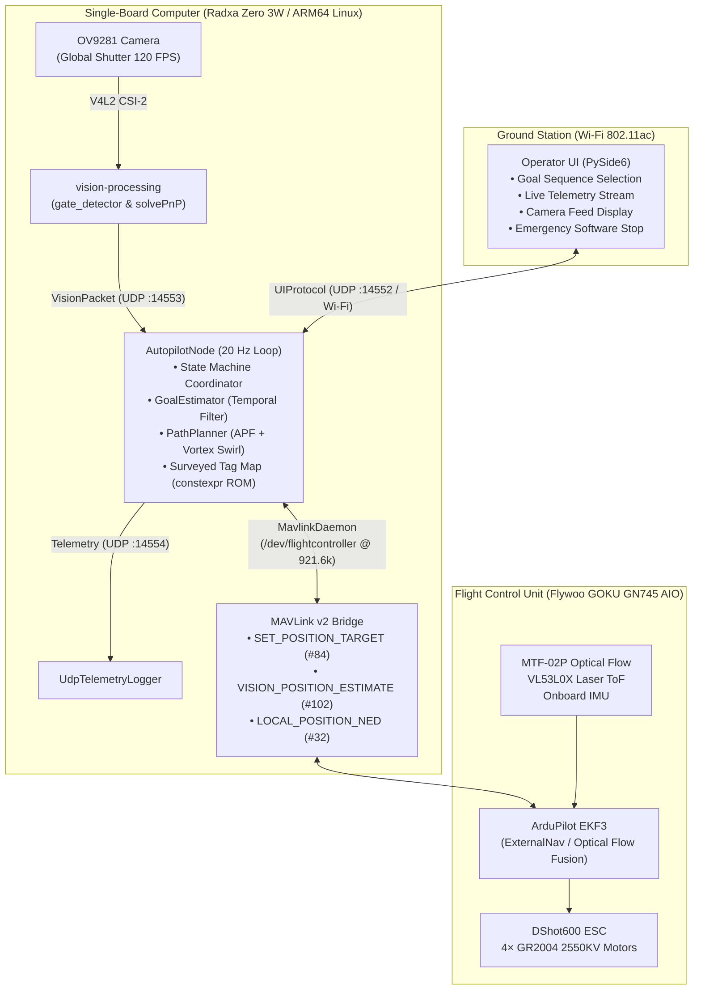

# HEXAGON Flight — Autonomous Sub-250g Indoor Drone

[](https://github.com/rylanmoseley/autonomous-drone/actions)
[](https://en.cppreference.com/w/cpp/17)
[](https://www.python.org/)
[](os/README.md)
[](#weight-and-power-budget)

**HEXAGON Flight (Team 03)** is a University of Kentucky Electrical and Computer Engineering Capstone Senior Design project. The team is engineering a fully autonomous, sub-250 g indoor quadcopter capable of real-time geometric shape recognition (Circle, Triangle, Square) and precision gate traversal in an arbitrary operator-specified sequence without relying on external motion-capture systems or GPS infrastructure.

Designed for live demonstration at the University of Kentucky Engineering Day (E-Day), the aircraft features an edge-computed vision pipeline and autonomous state machine running on a **Radxa Zero 3W** single-board companion computer communicating with an **ArduPilot** flight controller over a high-speed MAVLink UART bridge.

---

## Table of Contents

- [System Architecture](#system-architecture)
- [Repository Layout](#repository-layout)
- [Subproject Overview](#subproject-overview)
- [Hardware & Avionics](#hardware--avionics)
- [Weight & Power Budget](#weight--power-budget)
- [Key Engineering Requirements](#key-engineering-requirements)
- [Development Setup](#development-setup)
  - [Prerequisites](#prerequisites)
  - [Native Host Build](#native-host-build)
  - [Cross-Compilation (ARM64 / ARMHF)](#cross-compilation-arm64--armhf)
  - [Running Unit & Simulation Tests](#running-unit--simulation-tests)
- [Simulation & Visualizer](#simulation--visualizer)
- [OS Image Generation & Deployment](#os-image-generation--deployment)
- [Team Credits](#team-credits)

---

## System Architecture

The drone coordinates five decoupled software processes and hardware controllers using zero-copy binary Inter-Process Communication (IPC) over Unix Domain Sockets and UDP loops:



---

## Repository Layout

```
.
├── CMakeLists.txt              # Root CMake orchestration (C++17)
├── build_all.sh                # Multi-target build script (host, pi, radxa, all)
├── config/                     # Shared configuration templates
├── shared/                     # Zero-copy binary IPC packet contracts & MAVLink headers
│   ├── include/                # common_types.h, vision_packet.h, ui_protocol.h, mavlink_protocol.h
│   └── README.md
├── autopilot/                  # Autopilot node, estimators, APF planner, simulation harness
│   ├── autopilot_node.h/cpp    # Master 20 Hz state machine & coordinate registry
│   ├── goal-estimator/         # First-order exponential goal filter & variance tracker
│   ├── path-planner/           # Artificial Potential Field (APF) kinematic planner
│   ├── mavlink-daemon/         # High-speed MAVLink v2 serial/socket bridge
│   ├── sim/                    # 3D Software-in-the-Loop simulation & browser visualizer
│   ├── config/surveyed_tags.json # Arena fiducial tag survey configuration
│   ├── scripts/generate_tag_map.py # Pre-compile JSON-to-constexpr ROM code generator
│   └── README.md
├── vision-processing/          # Computer vision pipeline for shape identification & PnP
│   ├── include/gate_detector.h # Hierarchical contour search & 6-DoF pose solver
│   ├── src/gate_detector.cpp   # Implementation in SI meters
│   ├── AdvancedVisionTesting.cpp # Production vision daemon (vision_node)
│   ├── tests/                  # GoogleTest vision suite
│   └── README.md
├── os/                         # Embedded Linux OS builder for Radxa Zero 3W and Pi Zero 2W
│   ├── build_os.sh             # Dockerized rootfs builder and image synthesizer
│   ├── configs/                # Udev rules, systemd services, WiFi AP configs
│   └── README.md
├── flight-control/             # ArduPilot FCU configuration, wiring, and parameter specs
│   └── README.md
├── ui/                         # Operator Ground Control Interface (PySide6)
│   └── README.md
├── chassis/                    # 3D-printed PETG-CF airframe and drone course specifications
│   └── README.md
├── motors/                     # Propulsion, 4S LiPo power distribution, and motor tuning
│   └── README.md
└── cmake/                      # Cross-compilation toolchains (ARM64, ARMHF)
```

---

## Subproject Overview

| Subproject | Directory | Primary Role |
| :--- | :--- | :--- |
| **[Autopilot](autopilot/README.md)** | [`autopilot/`](autopilot/README.md) | High-level mission coordination, stateful goal tracking, APF obstacle avoidance, MAVLink bridge, and 3D simulation. |
| **[Vision Processing](vision-processing/README.md)** | [`vision-processing/`](vision-processing/README.md) | 120 FPS camera capture, OpenCV shape detection, 6-DoF relative pose estimation, and UDP packet broadcast. |
| **[Operating System](os/README.md)** | [`os/`](os/README.md) | Bootable Ubuntu Server 22.04 ARM64 image builder, WiFi AP mode (`Autonomous-Drone-AP`), systemd daemons, and low-latency RT-tuning. |
| **[Shared Contracts](shared/README.md)** | [`shared/`](shared/README.md) | Standardized, packed C/C++ binary wire protocol headers and MAVLink v2 encoder/decoder. |
| **[User Interface](ui/README.md)** | [`ui/`](ui/README.md) | PySide6 desktop application for sequence ordering, telemetry visualization, live video display, and emergency stop. |
| **[Flight Control](flight-control/README.md)** | [`flight-control/`](flight-control/README.md) | Flywoo GOKU GN745 AIO flight controller, optical flow / ToF sensor integration, and ArduPilot EKF3 tuning. |
| **[Chassis & Enclosure](chassis/README.md)** | [`chassis/`](chassis/README.md) | 3D-printed PETG-CF unibody duct airframe, modular landing gear, and 6x6x6 ft safety netting enclosure. |
| **[Motors & Power](motors/README.md)** | [`motors/`](motors/README.md) | GR2004 2550KV brushless motors, 4S 850 mAh LiPo battery, 5V/2A BEC, and power distribution harness. |

---

## Hardware & Avionics

```
+---------------------------------------------------------------------------------+
|                                 RADXA ZERO 3W                                   |
|   SoC: Rockchip RK3566 (Quad-Core Cortex-A55 @ 1.6 GHz)                         |
|   RAM: 2 GB / 4 GB LPDDR4 (2133 MT/s)                                           |
|   OS: Ubuntu Server 22.04 LTS ARM64 (Linux 5.10 RT-Tuned)                       |
|   Camera: OV9281 1MP Monochrome Global Shutter (MIPI CSI-2, 79 deg FOV)        |
+---------------------------------------+-----------------------------------------+
                                        | UART (/dev/ttyS4 @ 921,600 baud)
                                        v
+---------------------------------------------------------------------------------+
|                           FLYWOO GOKU GN745 AIO FCU                             |
|   Processor: STM32F745 (216 MHz)                                                |
|   Firmware: ArduPilot (ArduCopter 4.5+ with EKF3 ExternalNav)                   |
|   Sensors: MicoAir MTF-02P (Optical Flow) + VL53L0X (Laser ToF Distance)        |
|   ESC: 40A 4-in-1 BLHeli_S / Bluejay (DShot600 Protocol)                        |
|   Propulsion: 4× GR2004 2550KV Motors with 3.5-inch Gemfan Props                |
|   Power: 4S 850 mAh 150C LiPo Battery via Flywoo 5V/2A BEC                      |
+---------------------------------------------------------------------------------+
```

---

## Weight and Power Budget

Strict adherence to the **sub-250 g** limit ensures compliance with FAA Part 107 and University of Kentucky safety regulations:

### Mass Breakdown (Target: $\le 249.0\text{ g}$)
| Component | Budgeted Mass (g) | Actual Measured Mass (g) | Margin / Delta |
| :--- | :---: | :---: | :---: |
| 4× GR2004 Brushless Motors | 64.0 | 67.2 | +3.2 g |
| 4× 3.5" Propellers | 12.0 | 9.4 | -2.6 g |
| 4S 850 mAh 150C LiPo Battery | 100.0 | 99.0 | -1.0 g |
| Flywoo GOKU GN745 AIO FCU | 10.0 | 9.4 | -0.6 g |
| MTF-02P Flow & VL53L0X ToF Sensors | 4.0 | 3.0 | -1.0 g |
| Flywoo 5V/2A BEC Module | 0.5 | 0.5 | 0.0 g |
| Radxa Zero 3W SBC (with heatsink) | 15.0 | 15.0 | 0.0 g |
| OV9281 Camera Module & FPC Ribbon | 8.0 | 9.0 | +1.0 g |
| Race LEDs & Signal Wiring Harness | 1.0 | 0.7 | -0.3 g |
| 3D-Printed PETG-CF Airframe & Hardware | 25.0 | 25.0 | 0.0 g |
| **Total Takeoff Mass** | **239.5 g** | **238.2 g** | **+10.8 g under limit** |

### Power Consumption & Flight Endurance
- **Battery Capacity**: 4S LiPo (14.8 V nominal, 850 mAh = $12.58\text{ Wh}$).
- **Nominal Hover Current**: $9.25\text{ A}$ ($129.56\text{ W}$).
- **Estimated Flight Time**: **~6.0 minutes** continuous hover per pack (ER 17).
- **Field Operations**: 4-pack battery rotation with rapid 90-second cold-swap (ER 21) sustaining continuous multi-hour demonstrations.

---

## Key Engineering Requirements

| ER# | Metric | Implementation & Verification |
| :---: | :--- | :--- |
| **ER 1** | Stable hover: altitude drift $\le \pm 10\text{ cm}$, horizontal $\le \pm 15\text{ cm}$ over 30 s | Optical flow and ToF altitude fused with EKF3 visual fiducial drift resets. |
| **ER 3** | Controlled translational speed $v_{xy} \ge 0.60\text{ m/s}$ | Trajectory planner commands clamped between $0.6\text{ m/s}$ and $2.0\text{ m/s}$. |
| **ER 7** | Full 3-gate autonomous mission completed in $< 180\text{ s}$ | Closed-loop APF traversal verified in simulation ($< 120\text{ s}$). |
| **ER 8** | Gross Takeoff Mass $\le 249.0\text{ g}$ | Flight-ready hardware verified on calibrated scale at $238.2\text{ g}$. |
| **ER 9** | Failsafe landing/motor cut $\le 200\text{ ms}$ upon link loss | Watchdog timers in `AutopilotNode` monitor telemetry continuity. |
| **ER 10** | Emergency Stop motor de-energization $\le 150\text{ ms}$ | High-priority UDP interrupt commanding instantaneous MAVLink disarm override. |
| **ER 11** | Propeller duct tip clearance $\ge 2.0\text{ mm}$ under 5.0 N lateral load | Integrated structural duct rings printed in carbon-fiber PETG. |
| **ER 15** | Gate 3D position error $\le \pm 5.0\text{ cm}$ at $1.5\text{ m}$ distance | PnP pose solver validated with calibrated $566.8\text{ px}$ focal length. |
| **ER 22** | Body-frame drift $\le \pm 5.0\text{ cm/s}$ translational, $\le \pm 1.0^\circ/\text{s}$ yaw | Bounded by compile-time surveyed AprilTag position fixes. |
| **ER 23** | SBC core temperature $\le 75.0^\circ\text{ C}$ under full 30 FPS load | Zero-copy IPC and $O(\log N)$ ROM lookups minimize CPU consumption. |
| **ER 24** | Flight enclosure volume $\ge 6\times 6\times 6\text{ ft}$, mesh $\le 1\text{ in}$ | Modular PVC perimeter cage with commercial spectator safety netting. |

---

## Development Setup

### Prerequisites

For native Linux builds:
```bash
sudo apt update
sudo apt install -y build-essential cmake git python3 python3-pip libopencv-dev
```

For cross-compilation toolchains:
```bash
# ARM64 (Radxa Zero 3W)
sudo apt install -y gcc-aarch64-linux-gnu g++-aarch64-linux-gnu qemu-user-static

# ARMHF (Raspberry Pi Zero 2W)
sudo apt install -y gcc-arm-linux-gnueabihf g++-arm-linux-gnueabihf
```

---

### Native Host Build

To build the entire stack (including unit tests, simulation runner, and vision utilities):
```bash
./build_all.sh host
```
Alternatively, using CMake directly:
```bash
cmake -B build -DCMAKE_BUILD_TYPE=Release
cmake --build build -j$(nproc)
```

---

### Cross-Compilation (ARM64 / ARMHF)

Build cross-compiled binaries using the unified builder script:
```bash
# Build for Radxa Zero 3W (aarch64 / Cortex-A55)
./build_all.sh radxa

# Build for Raspberry Pi Zero 2W (armhf / Cortex-A53)
./build_all.sh pi

# Build all configurations sequentially
./build_all.sh all
```

The output executables are generated at:
- `build-radxa/autopilot/autopilot_node`
- `build-pi/autopilot/autopilot_node`

---

### Running Unit & Simulation Tests

Run the full GoogleTest suite through CTest:
```bash
# Native test suite (20 tests)
ctest --test-dir build --output-on-failure

# Cross-compiled ARM64 tests under QEMU emulation (19 tests)
ctest --test-dir build-radxa --output-on-failure

# Cross-compiled ARMHF tests under QEMU emulation (19 tests)
ctest --test-dir build-pi --output-on-failure
```

---

## Simulation & Visualizer

A Software-in-the-Loop (SIL) simulation environment allows iterating on autopilot logic, obstacle avoidance, and global drift correction without risking hardware:

1. **Launch the Web Simulation Server**:
   ```bash
   python3 autopilot/sim/sim_web.py --port 8080
   ```
2. **Open in Browser**:
   Navigate to `http://localhost:8080` to view the 3D arena, drone trajectory, gate apertures, and real-time state telemetry.
3. **Execute Standalone Scenarios**:
   ```bash
   # Run the closed-loop mission with tag drift handling
   ./build/autopilot/sim/autopilot_sim_runner --scenario tag_drift_correction --duration 30
   ```

---

## OS Image Generation & Deployment

To build a fresh, bootable Ubuntu Server image for the Radxa Zero 3W companion computer:

```bash
cd os
./build_os.sh radxa
```

Flash the generated image (`os/output/drone-os-radxa-zero3w.img.xz`) to a micro-SD card using `dd` or Raspberry Pi Imager. Once booted:
- The drone broadcasts a WiFi network: **`Autonomous-Drone-AP`** (Password: `DronePilot123`).
- Connect to the drone via SSH: `ssh drone@192.168.4.1` (or `ssh drone@drone.local`).
- Autopilot and Vision systemd daemons automatically start on boot with realtime priorities.

---

## Team Credits

**HEXAGON Flight — Senior Design Team 03**  
*Department of Electrical and Computer Engineering, University of Kentucky*

- **Rylan Moseley** — Autopilot & SBC Lead ([rylanmoseley@uky.edu](mailto:rylanmoseley@uky.edu))
- **Bo Adams** — Vision System Lead ([baad236@uky.edu](mailto:baad236@uky.edu))
- **Griffin Liem** — Airframe & Course Lead ([gali223@uky.edu](mailto:gali223@uky.edu))
- **Ellie Carter** — Power & Propulsion Lead ([emca264@uky.edu](mailto:emca264@uky.edu))
- **Angel Landaverde** — Sensors & Flight Control Lead ([anla240@uky.edu](mailto:anla240@uky.edu))
- **Kathryn Chumbley** — User Interface Lead ([klch230@uky.edu](mailto:klch230@uky.edu))

**Faculty Advisors**:
- **Dr. Robert Adams** (Project Sponsor)
- **Dr. Regina Hannemann** (Course Coordinator)
- **Dr. Sen-Ching Samson Cheung**
