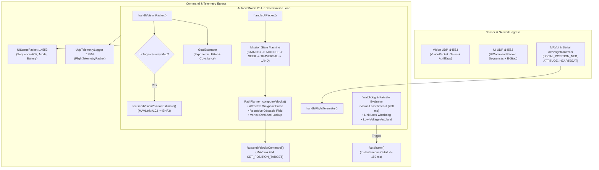

# Autopilot & Autonomy Subsystem

[](https://en.cppreference.com/w/cpp/17)
[-brightgreen.svg)](#core-architecture--loop-lifecycle)
[](../shared/include/mavlink_protocol.h)

The **Autopilot Subsystem** serves as the central coordination hub of the HEXAGON Flight autonomous quadcopter. Operating hierarchically on the companion Single-Board Computer (**Radxa Zero 3W**), it manages mission lifecycle state execution, stateful gate position filtering, kinematic trajectory generation with obstacle avoidance, MAVLink bridge execution to the ArduPilot Flight Controller Unit (FCU), and Software-in-the-Loop (SIL) simulation.

---

## Table of Contents

- [Core Architecture & Loop Lifecycle](#core-architecture--loop-lifecycle)
- [Subsystem Directory Layout](#subsystem-directory-layout)
- [Algorithmic Formulations](#algorithmic-formulations)
  - [1. Stateful Goal Position Estimator](#1-stateful-goal-position-estimator)
  - [2. Artificial Potential Field (APF) Path Planner](#2-artificial-potential-field-apf-path-planner)
  - [3. Authoritative Surveyed Tag Map (Compile-Time ROM)](#3-authoritative-surveyed-tag-map-compile-time-rom)
  - [4. MAVLink v2 Protocol & Drift Correction Bridge](#4-mavlink-v2-protocol--drift-correction-bridge)
- [Safety Watchdogs & Failsafes](#safety-watchdogs--failsafes)
- [Software-in-the-Loop (SIL) Simulation](#software-in-the-loop-sil-simulation)
- [Building & Testing](#building--testing)
  - [Host Compilation & CTest](#host-compilation--ctest)
  - [Embedded Cross-Compilation](#embedded-cross-compilation)
- [Deployment on SBC](#deployment-on-sbc)

---

## Core Architecture & Loop Lifecycle

The master coordination process [`AutopilotNode`](autopilot_node.h) executes a deterministic **20 Hz periodic loop** ($dt = 50\text{ ms}$):



---

## Subsystem Directory Layout

```
autopilot/
├── CMakeLists.txt                 # Autopilot build configuration & code generator rules
├── autopilot_node.h               # Master coordinating class declaration
├── autopilot_node.cpp             # Implementation of 20 Hz loop, state machine, and IPC
├── main.cpp                       # Production SBC entry point executable
├── config/
│   └── surveyed_tags.json         # Human-readable JSON arena survey of fiducial tags
├── scripts/
│   └── generate_tag_map.py        # Python pre-compiler generating constexpr ROM header
├── include/
│   └── generated_surveyed_tags.h  # Auto-generated zero-allocation ROM lookup table
├── goal-estimator/                # Goal tracking library
│   ├── goal_estimator.h
│   ├── goal_estimator.cpp
│   └── tests/test_estimator.cpp
├── path-planner/                  # Kinematic APF path planning library
│   ├── path_planner.h
│   ├── path_planner.cpp
│   └── tests/test_planner.cpp
├── mavlink-daemon/                # Zero-dependency MAVLink v2 serial/socket bridge
│   ├── mavlink_daemon.h
│   ├── mavlink_daemon.cpp
│   └── tests/test_mavlink.cpp
├── sim/                           # 3D Software-in-the-Loop simulation suite
│   ├── include/
│   │   ├── autopilot_sim_harness.h # Mock sensor injection & closed-loop verification
│   │   └── follower_simulator.h   # Kinematic quadcopter model with lag, noise & drift
│   ├── src/
│   │   ├── autopilot_sim_harness.cpp
│   │   ├── follower_simulator.cpp
│   │   └── sim_runner_main.cpp    # Headless CLI scenario runner
│   ├── sim_web.py                 # Real-time WebSocket 3D browser visualizer
│   └── tests/test_autopilot_sim.cpp
└── tests/
    └── test_autopilot.cpp         # Integration tests for state machine & ROM tag map
```

---

## Algorithmic Formulations

### 1. Stateful Goal Position Estimator
Incoming gate observations relative to the camera frame are transformed into World NED coordinates and filtered by [`GoalEstimator`](goal-estimator/goal_estimator.h) using a first-order exponential temporal filter:

$$\hat{p}_k = \alpha p_{\text{meas},k} + (1-\alpha)\hat{p}_{k-1}$$

where $\hat{p}_k = [\hat{x}_k, \hat{y}_k, \hat{z}_k]^T$ is the smoothed 3D position vector in the arena frame, $p_{\text{meas},k}$ is the instantaneous camera observation, and $\alpha = 0.5$ is the temporal smoothing factor. The estimator tracks running spatial variance:

$$\sigma_k^2 = (1-\alpha)\sigma_{k-1}^2 + \alpha |p_{\text{meas},k} - \hat{p}_k|^2$$

Goal tracking states transition deterministically:
- `SEARCHING (0)`: No detections or high measurement noise.
- `CONVERGING (1)`: Target detected; accumulating confidence.
- `LOCKED (2)`: Spatial variance satisfies $\sigma^2 \le 0.04\text{ m}^2$ (ready for flight traversal).
- `OCCLUDED (3)`: Target lost for $> 0.5\text{ s}$; persists last known estimate before re-searching.

---

### 2. Artificial Potential Field (APF) Path Planner
The kinematic solver [`PathPlanner`](path-planner/path_planner.h) computes 3D translational velocity vectors to guide the quadcopter cleanly through target gates while avoiding collisions with non-target obstacles.

For each target gate, trajectory generation establishes approach and exit waypoints offset along the gate aperture normal $\hat{n}_{\text{gate}}$:
$$w_{\text{approach}} = \hat{p}_{\text{gate}} - d_{\text{standoff}} \hat{n}_{\text{gate}}, \quad w_{\text{exit}} = \hat{p}_{\text{gate}} + d_{\text{standoff}} \hat{n}_{\text{gate}}$$
with standoff distance $d_{\text{standoff}} = 0.50\text{ m}$.

The commanded velocity combines three vector components:
1. **Attractive Field**: Guides vehicle toward the active waypoint:
   $$v_{\text{att}} = k_{\text{att}} \frac{w - p}{\|w - p\|}$$
2. **Repulsive Obstacle Field**: Pushes away from non-target obstacles within influence radius $d_{\text{influence}}$:
   $$v_{\text{rep},i} = k_{\text{rep}} \left(\frac{1}{d_i} - \frac{1}{d_{\text{influence}}}\right) \frac{r_i}{d_i^3}$$
3. **Orthogonal Vortex Swirl Field**: Injected perpendicular to the line of centers to prevent collinear local minima lockup:
   $$v_{\text{vortex},i} = k_{\text{vortex}} [-r_{y,i}, r_{x,i}, 0]^T$$

The total velocity vector is clamped against physical kinematic ceilings:
$$v_{\text{cmd}} = \operatorname{clamp}\left(v_{\text{att}} + \sum v_{\text{rep},i} + \sum v_{\text{vortex},i}, v_{\max}\right)$$
with $v_{xy,\max} = 2.0\text{ m/s}$ horizontally and $v_{z,\max} = 1.0\text{ m/s}$ vertically, satisfying **ER 3** and **ER 6**.

---

### 3. Authoritative Surveyed Tag Map (Compile-Time ROM)
As established in system requirements, **the Autopilot (not the FCU) is the authoritative owner of the arena survey coordinates**.

1. **Configuration**: Surveyed tags are specified in human-readable JSON ([`config/surveyed_tags.json`](config/surveyed_tags.json)):
   ```json
   {
     "id": 1,
     "label": "Gate 1 Entrance Marker",
     "position_ned": [1.5, -0.3, 1.0],
     "attitude_rpy_deg": [0.0, 0.0, 0.0],
     "size_m": 0.16
   }
   ```
2. **Pre-Compile Code Generator**: CMake runs [`scripts/generate_tag_map.py`](scripts/generate_tag_map.py) whenever `surveyed_tags.json` is modified. It precomputes unit quaternions $(w, x, y, z)$ at build time, computes a SHA-256 fingerprint, and emits [`include/generated_surveyed_tags.h`](include/generated_surveyed_tags.h).
3. **Optimized ROM Table**: Emits `constexpr CompiledSurveyedTagEntry COMPILED_SURVEYED_TAGS[]` stored in flash/ROM (zero heap allocation, zero startup parsing overhead).
4. **Fast Lookup**: `findCompiledSurveyedTag(id)` provides branchless $O(\log N)$ binary search lookup.
5. **Node Preloading**: `loadCompiledSurveyedTags(*this)` is called directly in the `AutopilotNode` constructor, ensuring the drone is flight-ready upon boot.

---

### 4. MAVLink v2 Protocol & Drift Correction Bridge
[`MavlinkDaemon`](mavlink-daemon/mavlink_daemon.h) connects the SBC to the ArduPilot FCU over serial UART (`/dev/flightcontroller` at 921,600 baud):

- **Guidance Setpoints**: Transmits `SET_POSITION_TARGET_LOCAL_NED` (Msg #84) in GUIDED mode at 20 Hz.
- **Global Drift Handling**: When the vision system detects an AprilTag, `AutopilotNode` resolves its pose and forwards `VISION_POSITION_ESTIMATE` (Msg #102) to the FCU. ArduPilot's EKF3 fuses this measurement to instantly arrest accumulated optical flow dead-reckoning drift without requiring extra hardware wiring.
- **Telemetry Ingestion**: Decodes `LOCAL_POSITION_NED` (Msg #32), `ATTITUDE` (Msg #30), and `HEARTBEAT` (Msg #0) to update internal vehicle states.

---

## Safety Watchdogs & Failsafes

The subsystem implements three redundant software watchdogs:

1. **Vision Loss Watchdog**: If valid vision packets cease for more than `0.20 s` during autonomous flight, the autopilot triggers an immediate controlled descent or hold.
2. **Emergency Stop (E-Stop)**: An operator E-Stop command received from the UI triggers an instantaneous motor disarm override within $\le 150\text{ ms}$ (satisfying **ER 10**).
3. **Telemetry Link Watchdog**: If MAVLink telemetry heartbeats from the FCU drop for $> 200\text{ ms}$, the autopilot signals failsafe mode (satisfying **ER 9**).

---

## Software-in-the-Loop (SIL) Simulation

The simulation subsystem allows testing the complete autonomy stack on a standard workstation:

```bash
# 1. Start the real-time 3D web visualizer server
python3 autopilot/sim/sim_web.py --port 8080

# 2. Run a simulated autonomous mission scenario in another terminal
./build/autopilot/sim/autopilot_sim_runner --scenario nominal --duration 45

# 3. Test optical flow drift with AprilTag correction
./build/autopilot/sim/autopilot_sim_runner --scenario tag_drift_correction --duration 30
```

---

## Building & Testing

### Host Compilation & CTest
```bash
# Build with CMake
cmake -B build -DCMAKE_BUILD_TYPE=Release
cmake --build build -j$(nproc)

# Run full test suite (20 tests)
ctest --test-dir build --output-on-failure
```

### Embedded Cross-Compilation
```bash
# Cross-compile for Radxa Zero 3W (ARM64 / Cortex-A55)
./build_all.sh radxa

# Cross-compile for Raspberry Pi Zero 2W (ARMHF / Cortex-A53)
./build_all.sh pi
```

---

## Deployment on SBC

On the production Radxa Zero 3W companion computer, the autopilot binary runs as a dedicated systemd service:

```bash
# Check status of the running autopilot service
systemctl status drone-autopilot.service

# Inspect live service logs
journalctl -u drone-autopilot.service -f
```
The service launches `/opt/drone/bin/autopilot_node` with realtime FIFO scheduling priority (`SCHED_RR`), communicating with the flight controller over `/dev/flightcontroller`.
