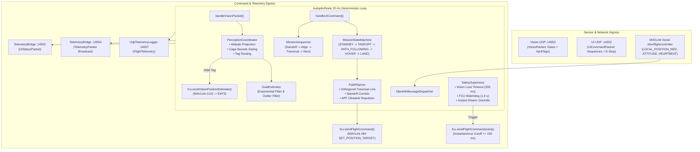

# Autopilot & Autonomy Subsystem

[](https://en.cppreference.com/w/cpp/17)
[-brightgreen.svg)](#core-architecture--loop-lifecycle)
[](../shared/include/mavlink_protocol.h)
[](#building--testing)

The **Autopilot Subsystem** serves as the central coordination hub of the HEXAGON Flight autonomous quadcopter. Operating on the companion Single-Board Computer (**Radxa Zero 3W**), it manages mission lifecycle states, stateful gate position filtering, 3D orthogonal trajectory planning, artificial potential field (APF) obstacle avoidance, MAVLink bridge execution to the ArduPilot Flight Controller Unit (FCU), and Software-in-the-Loop (SIL) simulation.

---

## Table of Contents

- [Core Architecture & Loop Lifecycle](#core-architecture--loop-lifecycle)
- [Subsystem Directory Layout](#subsystem-directory-layout)
- [Subsystem Documentation](#subsystem-documentation)
- [Algorithmic Formulations](#algorithmic-formulations)
  - [1. 3D Orthogonal Path Generation & Sign-Locked Traversal](#1-3d-orthogonal-path-generation--sign-locked-traversal)
  - [2. Stateful Goal Position Estimator & Outlier Rejection](#2-stateful-goal-position-estimator--outlier-rejection)
  - [3. Artificial Potential Field (APF) Path Planner](#3-artificial-potential-field-apf-path-planner)
  - [4. Authoritative Surveyed Tag Map (Compile-Time ROM)](#4-authoritative-surveyed-tag-map-compile-time-rom)
  - [5. MAVLink v2 Protocol & Drift Correction Bridge](#5-mavlink-v2-protocol--drift-correction-bridge)
- [Safety Watchdogs & Failsafes](#safety-watchdogs--failsafes)
- [Software-in-the-Loop (SIL) Simulation](#software-in-the-loop-sil-simulation)
- [Building & Testing](#building--testing)
  - [Host Compilation & CTest](#host-compilation--ctest)
  - [Embedded Cross-Compilation](#embedded-cross-compilation)
- [Deployment on SBC](#deployment-on-sbc)

---

## Core Architecture & Loop Lifecycle

The master coordination process [`AutopilotNode`](autopilot_node.h) executes a deterministic **20 Hz periodic loop** ($dt = 50\text{ ms}$):



---

## Subsystem Directory Layout

```
autopilot/
├── CMakeLists.txt                         # Autopilot build configuration & code generator rules
├── autopilot_node.h                       # Master coordinating class declaration
├── autopilot_node.cpp                     # Implementation of 20 Hz loop, state machine, and IPC
├── main.cpp                               # Production SBC entry point executable
├── mission_state_machine.h/.cpp           # FlightState transitions, takeoff & landing profiles
├── mission_sequencer.h/.cpp               # Waypoint sequence queue & goal progression phases
├── perception_coordinator.h/.cpp          # Surveyed tag registry & vision projection
├── safety_supervisor.h/.cpp               # Watchdogs & fail-safe emergency stop
├── telemetry_bridge.h/.cpp                # Socket lifecycle & UDP broadcasting
├── config/
│   └── surveyed_tags.json                 # Human-readable JSON arena survey of fiducial tags
├── scripts/
│   └── generate_tag_map.py                # Python pre-compiler generating constexpr ROM header
├── include/
│   └── generated_surveyed_tags.h          # Auto-generated zero-allocation ROM lookup table
├── docs/                                  # Detailed subsystem documentation
│   ├── README.md                          # Documentation index
│   ├── architecture.md                    # Threading, IPC, and coordinate frames
│   ├── mission_core.md                    # State machine & sequencer
│   ├── path_planner.md                    # Orthogonal line generator & APF
│   ├── goal_estimator.md                  # Noise filters & spatial tracking
│   ├── mavlink_daemon.md                  # MAVLink v2 bridge & codecs
│   └── simulation.md                      # SIL testbed & collision detectors
├── goal-estimator/                        # Modular goal tracking library
│   ├── tracked_goal.h                     # Data structures for tracked goals
│   ├── goal_track_filter.h/.cpp           # Alpha damping, jump filter, yaw symmetry
│   ├── goal_registry.h/.cpp               # Thread-safe track storage & timeouts
│   ├── goal_telemetry_formatter.h/.cpp    # Telemetry state formatting
│   ├── goal_estimator.h/.cpp              # Coordinator facade
│   └── tests/                             # Isolated unit tests
├── path-planner/                          # Modular path planning library
│   ├── kinematic_profile_filter.h/.cpp    # Velocity & acceleration saturation
│   ├── approach_corridor_planner.h/.cpp   # Standoff geometry & entrance corridor
│   ├── orthogonal_path_generator.h/.cpp   # 3D normal vectors & traversal paths
│   ├── obstacle_avoidance_potential_field.h/.cpp # Repulsive fields & exclusion
│   ├── phase_alignment_evaluator.h/.cpp   # Standoff arrival & punch-through
│   ├── path_planner.h/.cpp                # Coordinator facade
│   └── tests/                             # Isolated unit tests
├── mavlink-daemon/                        # Zero-dependency MAVLink v2 bridge
│   ├── mavlink_packet_codec.h/.cpp        # Msg #84 & Msg #102 framing & CRC
│   ├── mavlink_message_dispatcher.h/.cpp  # Inbound packet handling & NED/NEU conversion
│   ├── mavlink_network_channel.h/.cpp     # UDP socket lifecycle & receive thread
│   ├── mavlink_fcu_watchdog.h             # Connection watchdog
│   ├── mavlink_daemon.h/.cpp              # Coordinator facade
│   └── tests/                             # Isolated unit tests
└── sim/                                   # 3D Software-in-the-Loop simulation suite
    ├── include/
    │   ├── sim_types.h                    # Ground-truth simulation structures
    │   ├── collision_detector.h           # Torus rim & pylon collision model
    │   ├── sim_camera_perception.h        # Frustum FOV, occlusion & tag sightings
    │   ├── autopilot_sim_harness.h        # Closed-loop test harness
    │   └── follower_simulator.h           # Kinematic drone model with lag, noise & drift
    ├── src/
    │   ├── collision_detector.cpp
    │   ├── sim_camera_perception.cpp
    │   ├── autopilot_sim_harness.cpp
    │   ├── follower_simulator.cpp
    │   └── sim_runner_main.cpp            # Headless CLI scenario runner
    ├── sim_web.py                         # Real-time WebSocket 3D browser visualizer
    └── tests/                             # SIL unit and scenario tests
```

---

## Subsystem Documentation

Comprehensive technical documentation for each component is available in [`docs/`](docs/README.md):

- [**System Architecture & Threading Model**](docs/architecture.md)
- [**Mission Core & State Machine**](docs/mission_core.md)
- [**Path Planner Subsystem**](docs/path_planner.md)
- [**Goal Estimator Subsystem**](docs/goal_estimator.md)
- [**MAVLink Daemon Subsystem**](docs/mavlink_daemon.md)
- [**Simulation Subsystem & Collision Detection**](docs/simulation.md)

---

## Algorithmic Formulations

### 1. 3D Orthogonal Path Generation & Sign-Locked Traversal
The drone traverses each gate strictly along a 3D line segment perpendicular to the gate aperture through its widest point ([`OrthogonalPathGenerator`](path-planner/orthogonal_path_generator.h)):

1. **3D Unit Normal Vector**: Derived from the gate's 3D orientation ($\phi, \theta, \psi$):
   $$\hat{n} = [\cos(\psi)\cos(\theta), \ \sin(\psi)\cos(\theta), \ -\sin(\theta)]^T$$
2. **Traversal Sign Locking**: Determined by the vehicle's initial entrance side:
   $$\Delta = (p_{\text{drone}} - p_{\text{gate}}) \cdot \hat{n}$$
   If $\Delta \ge 0$, entry is from the $+ \hat{n}$ face (`traversal_sign = -1.0`); otherwise entry is from the $- \hat{n}$ face (`traversal_sign = +1.0`). Once assigned, the direction sign is strictly locked to prevent corridor flips under sensor noise.
3. **Standoff Targets**: With standoff $d_s = 0.75\text{ m}$:
   $$p_{\text{entry}} = p_{\text{gate}} - \text{sign} \cdot d_s \cdot \hat{n}, \quad p_{\text{exit}} = p_{\text{gate}} + \text{sign} \cdot d_s \cdot \hat{n}$$

---

### 2. Stateful Goal Position Estimator & Outlier Rejection
Incoming gate observations are filtered by [`GoalEstimator`](goal-estimator/goal_estimator.h) using exponential temporal smoothing and multi-frame glitch rejection:

1. **Exponential Smoothing**:
   $$\hat{p}_k = \alpha_{\text{eff}} \cdot p_{\text{meas}} + (1 - \alpha_{\text{eff}}) \cdot \hat{p}_{k-1}$$
   Damped to $\alpha_{\text{eff}} = 0.125$ for edge-clipped or low-confidence contours.
2. **Spatial Outlier Rejection**: Discards single-frame anomalous jumps $> 0.35\text{ m}$. If $\ge 3$ consecutive frames confirm the new location, the filter concludes the gate legitimately moved and snaps to the new position.
3. **Planar Yaw Symmetry Projection**: For planar symmetric gates, normal vector flips $> 90^\circ$ are projected back:
   $$\Delta\psi \leftarrow \Delta\psi - \operatorname{sgn}(\Delta\psi)\pi \quad \text{if } |\Delta\psi| > \frac{\pi}{2}$$

---

### 3. Artificial Potential Field (APF) Path Planner
The kinematic planner ([`PathPlanner`](path-planner/path_planner.h)) combines waypoint guidance with obstacle avoidance:

1. **Attractive Field**: Guides vehicle toward active waypoint $w$:
   $$v_{\text{att}} = k_{\text{att}} \frac{w - p}{\|w - p\|}$$
2. **Repulsive Obstacle Field**: Repels vehicle from non-target gates within influence radius $d_{\text{influence}} = 0.80\text{ m}$:
   $$v_{\text{rep},i} = k_{\text{rep}} \left(\frac{1}{d_i} - \frac{1}{d_{\text{influence}}}\right) \frac{r_i}{d_i^3}$$
3. **Kinematic Clamping**: Enforces horizontal ceiling $v_{xy,\max} = 2.0\text{ m/s}$, vertical ceiling $v_{z,\max} = 1.0\text{ m/s}$, and yaw rate $\dot{\psi}_{\max} = 1.0\text{ rad/s}$.

---

### 4. Authoritative Surveyed Tag Map (Compile-Time ROM)
The Autopilot is the authoritative owner of the arena survey coordinates:
1. Tags are defined in [`config/surveyed_tags.json`](config/surveyed_tags.json).
2. CMake compiles this into a zero-allocation `constexpr` lookup table [`include/generated_surveyed_tags.h`](include/generated_surveyed_tags.h).
3. Preloaded into [`AutopilotNode`](autopilot_node.h) at startup (`loadCompiledSurveyedTags`).

---

### 5. MAVLink v2 Protocol & Drift Correction Bridge
[`MavlinkDaemon`](mavlink-daemon/mavlink_daemon.h) connects the companion computer to ArduPilot:
- **Guidance Setpoints**: Transmits `SET_POSITION_TARGET_LOCAL_NED` (Msg #84) in GUIDED mode at 20 Hz.
- **Global Drift Handling**: Forwards observed AprilTags as `VISION_POSITION_ESTIMATE` (Msg #102) to the FCU, arresting optical flow dead-reckoning drift in EKF3.
- **Telemetry Ingestion**: Decodes `LOCAL_POSITION_NED` (Msg #32), `ATTITUDE` (Msg #30), and `HEARTBEAT` (Msg #0).

---

## Safety Watchdogs & Failsafes

1. **Vision Loss Watchdog**: If vision packets cease for $> 0.20\text{ s}$ during autonomous flight, an E-Stop is triggered.
2. **Emergency Stop (E-Stop)**: UI E-Stop disarms motors within $\le 150\text{ ms}$ (**ER 10**).
3. **Telemetry Link Watchdog**: Failsafe mode triggers if FCU heartbeats drop for $> 1.0\text{ s}$ (**ER 9**).

---

## Software-in-the-Loop (SIL) Simulation

```bash
# 1. Start the real-time 3D web visualizer server
python3 autopilot/sim/sim_web.py --port 8080

# 2. Run automated headless scenario verification
./build/autopilot/sim/autopilot_sim_runner --scenario nominal --duration 45

# 3. Test optical flow drift with AprilTag correction
./build/autopilot/sim/autopilot_sim_runner --scenario tag_drift_correction --duration 30
```

---

## Building & Testing

### Host Compilation & CTest
```bash
# Configure and build
cmake -B build -DCMAKE_BUILD_TYPE=Release
cmake --build build -j$(nproc)

# Run full CTest suite (68 tests)
ctest --test-dir build --output-on-failure

# Run Python simulation test suite (24 tests)
python3 -m unittest discover -s autopilot/sim/tests/
```

### Embedded Cross-Compilation
```bash
# Cross-compile for Radxa Zero 3W (ARM64 / Cortex-A55)
./build_all.sh radxa

# Cross-compile for Raspberry Pi Zero 2W (ARMHF / Cortex-A53)
./build_all.sh pi
```

---

## Deployment on SBC

On the production Radxa Zero 3W companion computer, the autopilot binary runs as a dedicated systemd service:

```bash
# Check status of the running autopilot service
systemctl status drone-autopilot.service

# Inspect live service logs
journalctl -u drone-autopilot.service -f
```
The service launches `/opt/drone/bin/autopilot_node` with realtime FIFO scheduling priority (`SCHED_RR`), communicating with the flight controller over `/dev/flightcontroller`.
