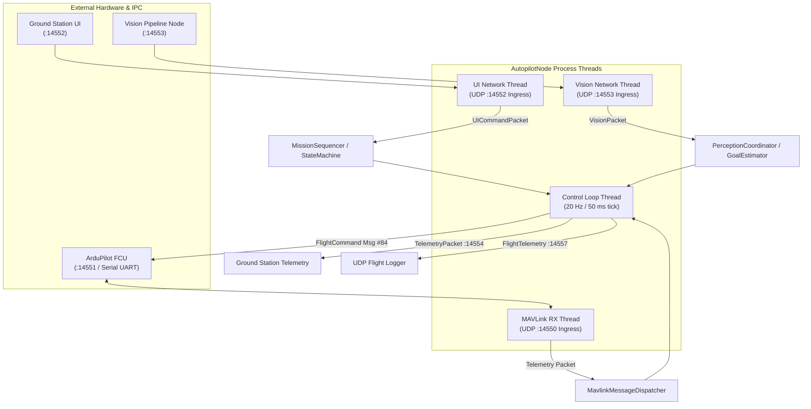

# Autopilot System Architecture

The **Autopilot Subsystem** coordinates mission execution on the companion Single-Board Computer (**Radxa Zero 3W**), interfacing between perception algorithms, ground control UI, and the ArduPilot Flight Controller Unit (FCU).

---

## 1. High-Level Threading & Process Model

The main coordinator process [`AutopilotNode`](../autopilot_node.h) coordinates four concurrent execution contexts:



### Thread Responsibilities

1. **Control Loop Thread (`run`)**:
   - Executes deterministically at 20 Hz ($dt = 50\text{ ms}$).
   - Queries current vehicle state from `MavlinkDaemon`.
   - Calls `tick(current_pose, dt)`.
   - Dispatches setpoint guidance commands (`FlightCommand`) to the FCU via MAVLink Msg #84 (`SET_POSITION_TARGET_LOCAL_NED`).
   - Broadcasts binary `TelemetryPacket` on port 14554 and logs telemetry on port 14557.
2. **UI Thread (`ui_loop`)**:
   - Asynchronously listens for incoming `UICommandPacket` datagrams on UDP port 14552.
   - Dispatches arming, disarming, mission starts, waypoints, pause/resume, and emergency stops.
   - Emits acknowledgment and status responses via `UIStatusPacket`.
3. **Vision Ingress Thread (`vision_loop`)**:
   - Asynchronously ingests `VisionPacket` datagrams on UDP port 14553 from the onboard OpenCV perception pipeline.
   - Passes observed gate hypotheses and fiducial tag observations to `PerceptionCoordinator`.
4. **MAVLink RX Thread (`MavlinkNetworkChannel::receiveLoop`)**:
   - Ingests incoming FCU packets (MAVLink `#30 ATTITUDE`, `#32 LOCAL_POSITION_NED`, `#0 HEARTBEAT`).
   - Performs CRC-16 validation and unpacks coordinates for flight telemetry consumption.

---

## 2. Coordinate System Conventions

The Autopilot manages three primary coordinate frames:

1. **World Frame (NED / NEU)**:
   - Fixed to the competition arena floor.
   - In standard ArduPilot MAVLink coordinates, $X$ is North, $Y$ is East, $Z$ is Down (NED).
   - In the internal Autopilot planner and status packets, altitude is treated positively upward (NEU: $Z_{neu} = -Z_{ned}$). The `MavlinkMessageDispatcher` handles bidirectional conversions.
2. **Body Frame**:
   - Fixed to the center of mass of the quadcopter.
   - $+X_{body}$ points forward along the nose.
   - $+Y_{body}$ points to the vehicle's right side.
   - $+Z_{body}$ points downward (or upward depending on representation).
3. **Camera Frame**:
   - Origin offset by the physical camera mount: $p_{\text{cam,mount}} = (+0.18\text{ m forward}, +0.04\text{ m up})$.
   - Optical axis points along $+Z_{\text{cam}}$, lateral horizontal axis is $+X_{\text{cam}}$, and downward vertical axis is $+Y_{\text{cam}}$.

---

## 3. Subsystem Modularity Architecture

Each functional subsystem has been partitioned into discrete modules with isolated unit test targets:

```
autopilot/
├── mission_state_machine.h/.cpp        # FlightState transitions & maneuver targets
├── mission_sequencer.h/.cpp            # Waypoint sequence queue & goal phases
├── perception_coordinator.h/.cpp        # Surveyed tag registry & vision projection
├── safety_supervisor.h/.cpp            # Watchdogs & fail-safe emergency stop
├── telemetry_bridge.h/.cpp             # Socket lifecycle & packet broadcasting
├── autopilot_node.h/.cpp               # Top-level facade coordinating threads
├── path-planner/                       # Modular trajectory & APF avoidance
├── goal-estimator/                     # Stateful gate tracking & spatial filters
├── mavlink-daemon/                     # MAVLink v2 encoder/decoder/dispatcher
└── sim/                                # SIL simulator & collision detection
```
