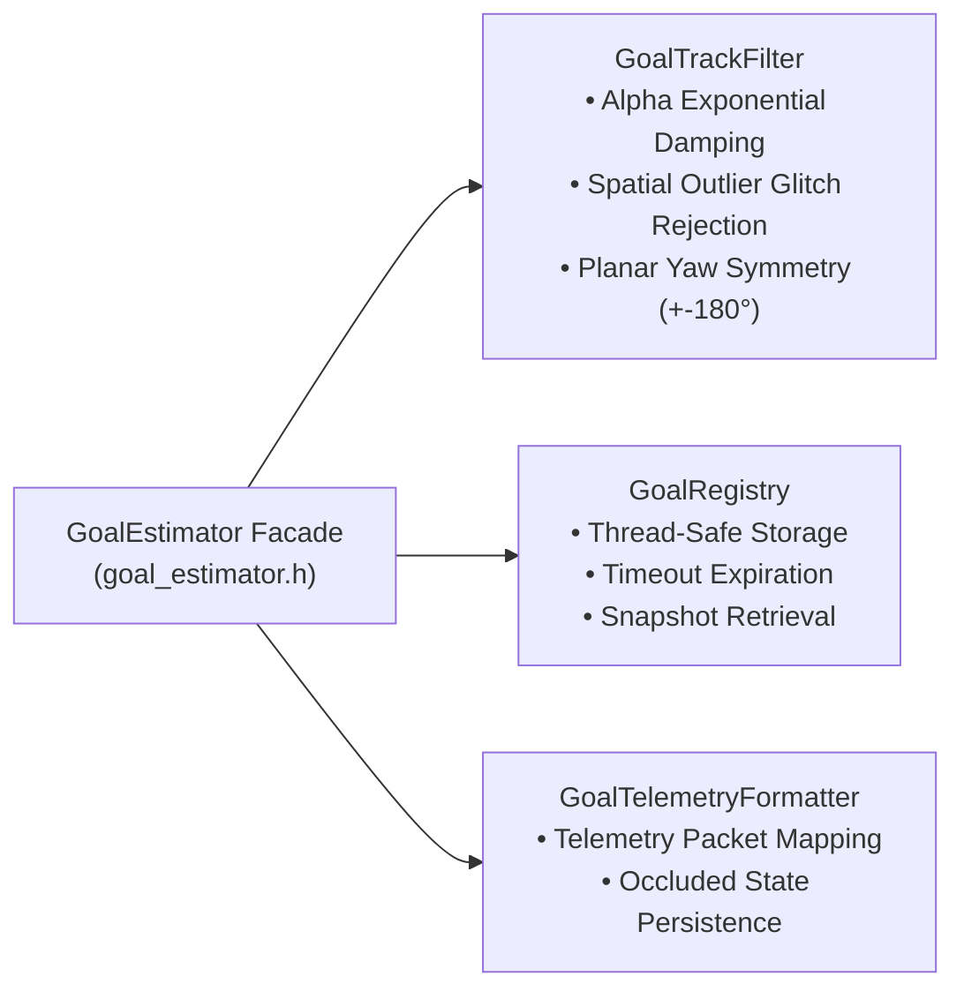

# Goal Estimator Subsystem

The **Goal Estimator Subsystem** filters instantaneous, noisy optical detections from the vision pipeline into stable 3D world pose estimates for flight guidance.

---

## Modular Component Structure

---

## 1. Goal Track Filter ([`goal_track_filter.h`](../goal-estimator/goal_track_filter.h))

The `GoalTrackFilter` operates on individual gate tracks, implementing critical noise and glitch rejection algorithms:

### First-Order Alpha Smoothing
For a validated measurement $p_{\text{meas}}$ and prior estimate $\hat{p}_{k-1}$:
$$\hat{p}_k = \alpha_{\text{eff}} \cdot p_{\text{meas}} + (1 - \alpha_{\text{eff}}) \cdot \hat{p}_{k-1}$$
Nominal $\alpha = 0.50$. For marginal or edge-clipped contour detections ($\text{confidence} < 0.85$), updates are damped with $\alpha_{\text{eff}} = \alpha \times 0.25 = 0.125$.

### Spatial Outlier Glitch Rejection (Multi-Frame Relocation)
Optical noise can occasionally produce single-frame false contour detections meters away from the real gate:
- If a locked track receives a measurement jumping by $> 0.35\text{ m}$, the single-frame glitch is **discarded**.
- An internal counter `outlier_jump_counts_` increments.
- If $\ge 3$ consecutive frames report the new position, the filter concludes the gate was legitimately moved and immediately snaps to the new coordinates.

### Planar Yaw Symmetry Projection ($\pm 180^\circ$ Equivalence)
Planar gates (circular hoops, triangular frames, square gates) look geometrically identical from the front and back. The vision system may intermittently flip normal vectors by $180^\circ$ ($|\Delta\psi| > \pi/2$):
$$\text{If } |\Delta\psi| > \frac{\pi}{2}, \quad \Delta\psi \leftarrow \Delta\psi - \operatorname{sgn}(\Delta\psi)\pi$$
This projects the observed angle back along the active normal axis, preventing spurious $180^\circ$ yaw spins during approach.

---

## 2. Goal Registry ([`goal_registry.h`](../goal-estimator/goal_registry.h))

Manages thread-safe storage for active and historical gate estimates:
- **`tracked_goals_`**: Active tracks receiving recent optical updates.
- **`last_known_goals_`**: Memory cache persisting the last converged coordinates of each gate.
- **`getActiveEstimates(current_time)`**: Returns tracks updated within `timeout_sec_` ($2.0\text{ s}$).
- **`getLastKnownGoal(shape_type)`**: Provides stale coordinates for search and relocalization even after direct visual line-of-sight is lost.

---

## 3. Goal Telemetry Formatter ([`goal_telemetry_formatter.h`](../goal-estimator/goal_telemetry_formatter.h))

Formats internal tracks into `GoalTrackTelemetry` for ground station broadcast across three slots (`SHAPE_CIRCLE`, `SHAPE_TRIANGLE`, `SHAPE_SQUARE`):
- `TRACK_STATE_LOCKED`: Actively observed within timeout.
- `TRACK_STATE_OCCLUDED`: Timed out, but retained in `last_known_goals_`.
- `TRACK_STATE_SEARCHING`: Unobserved / uninitialized.
