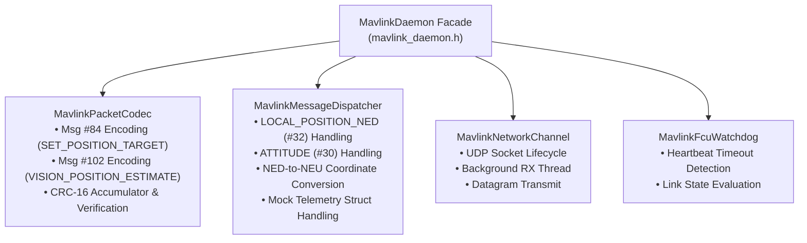

# MAVLink Daemon Subsystem

The **MAVLink Daemon Subsystem** provides a zero-dependency, high-throughput communication bridge between the Autopilot companion SBC and the ArduPilot Flight Controller Unit (FCU).

---

## Modular Component Structure

---

## 1. Packet Codec ([`mavlink_packet_codec.h`](../mavlink-daemon/mavlink_packet_codec.h))

Implements zero-dependency MAVLink v2 packet framing (`0xFD` magic byte):

### Msg #84 — `SET_POSITION_TARGET_LOCAL_NED`
Encodes position setpoints for flight control:
- Target coordinates: $(x, y, -z)$ — converts internal positive altitude (NEU) to ArduPilot negative $Z$ (NED).
- Type mask: `0x0DF8` (controls 3D position and yaw; ignores velocity and acceleration).
- Target system: `1`, Component: `MAV_COMP_ID_AUTOPILOT1` (`1`).
- Source component: `MAV_COMP_ID_ONBOARD_COMPUTER` (`191`).

### Msg #102 — `VISION_POSITION_ESTIMATE`
Encodes AprilTag world pose measurements for FCU global drift correction:
- Microsecond mid-exposure timestamp.
- Global camera position $(x, y, z)$ in NED coordinates.
- Attitude angles (roll, pitch, yaw).
- Covariance matrix: position variance derived from tag confidence heuristic.
- Source component: `MAV_COMP_ID_VISUAL_INERTIAL_ODOMETRY` (`197`).

### CRC-16 Checksum Verification
Validates packet integrity via CRC-16-MCRF4XX accumulation combined with message-specific `CRC_EXTRA` seeds:
- Discards packets with corrupted checksums or mismatched lengths.

---

## 2. Message Dispatcher ([`mavlink_message_dispatcher.h`](../mavlink-daemon/mavlink_message_dispatcher.h))

Maintains thread-safe vehicle state from incoming datagrams:
- **`LOCAL_POSITION_NED` (Msg #32)**: Updates $(x, y, z)$ with coordinate conversion ($z_{\text{neu}} = -z_{\text{ned}}$).
- **`ATTITUDE` (Msg #30)**: Updates vehicle roll, pitch, and yaw.
- **Direct Mock Structs**: Recognizes raw `Telemetry` structs sent by unit test harnesses for fast headless execution without socket encoding overhead.

---

## 3. Network Channel ([`mavlink_network_channel.h`](../mavlink-daemon/mavlink_network_channel.h))

Manages the UDP socket connection:
- Default Local Port: `14550`.
- Remote Target: `127.0.0.1:14551` (or physical serial bridge proxy on `/dev/flightcontroller`).
- Background receiver thread with non-blocking timeouts (`SO_RCVTIMEO`).
