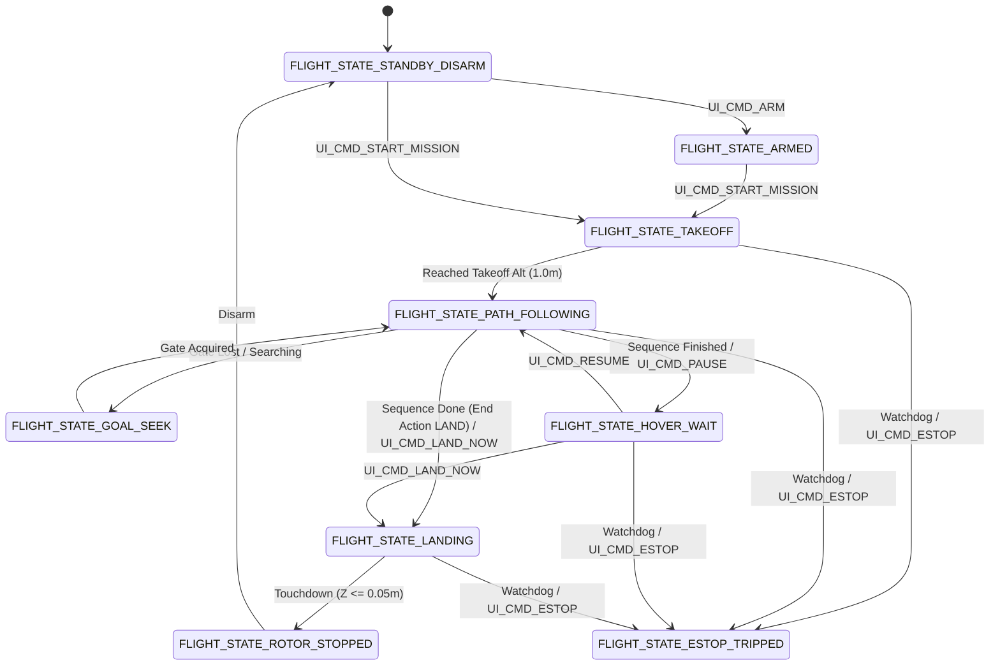

# Mission Core & State Machine

The **Mission Core** manages mission lifecycle execution, waypoint sequencing, safety monitoring, perception coordination, and ground station telemetry bridging.

---

## 1. Mission State Machine ([`mission_state_machine.h`](../mission_state_machine.h))

The `MissionStateMachine` implements the deterministic state machine governing vehicle behavior:

### Key Functions
- **`handleStartMissionCommand(bool in_air)`**: Initiates takeoff if starting from ground, or enters `PATH_FOLLOWING` immediately if already hovering in-flight.
- **`computeTakeoffTarget(current_pose, use_tube, tube_rail_z)`**: Calculates vertical climb target ($1.0\text{ m}$ default, or respects `tube_rail_z`).
- **`computeLandingStep(current_pose, dt, out_touchdown)`**: Computes linear descent ramp ($0.40\text{ m/s}$) and detects ground contact ($Z \le 0.05\text{ m}$).
- **`computeHoverHold(current_pose, has_hover, hover_pose)`**: Freezes position setpoint to the initial hover coordinate.

---

## 2. Mission Sequencer ([`mission_sequencer.h`](../mission_sequencer.h))

The `MissionSequencer` maintains the active gate sequence and tracks gate progression through three deterministic phases:

1. **Phase 0 — Standoff Approach**:
   - The drone flies toward an entrance standoff point offset from the gate center along its normal axis.
   - Non-target gate repulsion is actively calculated to prevent clipping neighboring structures.
2. **Phase 1 — Boresight Alignment**:
   - The drone hovers in front of the gate aperture, refining camera boresight alignment and matching gate orientation before attempting traversal.
3. **Phase 2 — Orthogonal Traversal**:
   - Traversal sign is locked. The drone follows a line segment strictly orthogonal to the gate aperture through its widest point to the exit standoff point.
4. **Sequence Advancement**:
   - Once exit criteria are satisfied, `advanceSequence()` increments `current_seq_index`, resets phase ticks, and unlocks tracking for the next target shape.

---

## 3. Perception Coordinator ([`perception_coordinator.h`](../perception_coordinator.h))

The `PerceptionCoordinator` manages surveyed tag anchors and camera coordinate transformations:

- **Surveyed Tag Registry**:
  Stores high-precision surveyed anchors in world coordinates. Registered via ROM tables at startup (`loadCompiledSurveyedTags`) or dynamic API.
- **3D Attitude-Compensated Projection**:
  Transforms raw optical gate hypotheses ($p_{\text{cam}}$) into World coordinates using current vehicle attitude ($\phi, \theta, \psi$) and camera mounting offsets ($+0.18\text{ m}$ forward, $+0.04\text{ m}$ up).
- **Arena Cage Bounds Filtering**:
  Rejects spurious contour false positives outside physical cage boundaries ($0.20\text{ m} \le Z \le 2.30\text{ m}$, $-2.0\text{ m} \le X \le 8.0\text{ m}$, $|Y| \le 4.0\text{ m}$).
- **Tag Pass-Through Forwarding**:
  Validates observed AprilTags against the surveyed tag registry and forwards valid measurements to the FCU via `MavlinkDaemon::sendVisionPositionEstimate` (MAVLink Msg #102) for real-time EKF3 drift correction.

---

## 4. Safety Supervisor ([`safety_supervisor.h`](../safety_supervisor.h))

The `SafetySupervisor` enforces continuous flight safety watchdogs:

- **Vision Watchdog**: Tracks elapsed time since the last valid `VisionPacket`. If time exceeds `vision_timeout_s_` ($2.5\text{ s}$ default, configurable down to $0.20\text{ s}$ for competition runs), an E-Stop is triggered.
- **FCU Telemetry Watchdog**: Monitors heartbeat and position telemetry from ArduPilot. If lost for $> 1.0\text{ s}$, an E-Stop is tripped.
- **E-Stop Command (`createEstopCommand`)**: Emits a `FlightCommand` with `enable = false`, `estop = true` to immediately cut motor throttle.

---

## 5. Telemetry Bridge ([`telemetry_bridge.h`](../telemetry_bridge.h))

Manages low-level UDP sockets:
- **Port 14552**: Bidirectional UI command and `UIStatusPacket` telemetry.
- **Port 14553**: Ingress socket for `VisionPacket` datagrams from `vision_node`.
- **Port 14554**: Broadcast socket emitting binary `TelemetryPacket` structures for visualization.
