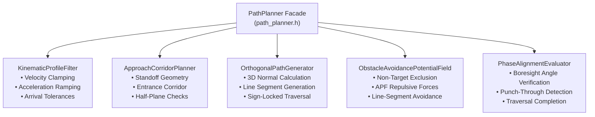

# Path Planner Subsystem

The **Path Planner Subsystem** generates continuous 3D velocity and position setpoints for gate approach, orthogonal line tracking, and artificial potential field (APF) obstacle avoidance.

---

## Modular Component Structure

The subsystem is organized into 5 focused modules coordinated by a facade:

---

## 1. Orthogonal Path Generator ([`orthogonal_path_generator.h`](../path-planner/orthogonal_path_generator.h))

To satisfy mission requirements, the drone traverses each gate strictly along a line perpendicular to the gate face through its widest point.

### 3D Normal Vector Formulation
Given a gate orientation with roll $\phi$, pitch $\theta$, and yaw $\psi$, the 3D unit normal vector $\hat{n} = [n_x, n_y, n_z]^T$ is computed:
$$n_x = \cos(\psi)\cos(\theta), \quad n_y = \sin(\psi)\cos(\theta), \quad n_z = -\sin(\theta)$$

### Traversal Sign Locking
The generator checks which standoff side is closest to the drone when entering the gate corridor:
$$\Delta = (p_{\text{drone}} - p_{\text{gate}}) \cdot \hat{n}$$
- If $\Delta \ge 0$, entry is from the $+ \hat{n}$ side (`traversal_sign = -1.0`).
- If $\Delta < 0$, entry is from the $- \hat{n}$ side (`traversal_sign = +1.0`).
Once assigned, `traversal_sign` is strictly locked to prevent mid-traversal corridor flips if the drone drifts across the plane.

### Entry and Exit Points
With standoff distance $d_s = 0.75\text{ m}$:
$$p_{\text{entry}} = p_{\text{gate}} - \text{sign} \cdot d_s \cdot \hat{n}, \quad p_{\text{exit}} = p_{\text{gate}} + \text{sign} \cdot d_s \cdot \hat{n}$$

---

## 2. Obstacle Avoidance Potential Field ([`obstacle_avoidance_potential_field.h`](../path-planner/obstacle_avoidance_potential_field.h))

To avoid colliding with non-target gates or physical obstacles in the arena:

1. **Keep-Out Buffer**: Each obstacle is treated as an exclusion cylinder with influence radius $d_{\text{influence}} = 0.80\text{ m}$ and physical safety margin $r_{\text{safe}} = 0.50\text{ m}$.
2. **Repulsive Velocity**:
   $$\vec{v}_{\text{rep}} = k_{\text{rep}} \left(\frac{1}{d} - \frac{1}{d_{\text{influence}}}\right) \frac{\vec{r}}{d^3}$$
   where $\vec{r}$ is the vector from obstacle to drone.
3. **Trajectory Segment Clearance**: Verifies that the proposed approach and traversal paths do not intersect the exclusion cylinder of any other known obstacle.

---

## 3. Kinematic Profile Filter ([`kinematic_profile_filter.h`](../path-planner/kinematic_profile_filter.h))

Enforces vehicle kinematic boundaries:
- **Horizontal Velocity Ceiling**: Clamped to $v_{xy,\max} = 2.0\text{ m/s}$.
- **Vertical Velocity Ceiling**: Clamped to $v_{z,\max} = 1.0\text{ m/s}$.
- **Yaw Rate Ceiling**: Clamped to $\dot{\psi}_{\max} = 1.0\text{ rad/s}$.
- **Acceleration Limiter**: Steps velocity increments so $\|a\| \le a_{\max} = 100.0\text{ m/s}^2$.
- **Arrival Tolerance**: Evaluates Euclidean arrival tolerance ($0.20\text{ m}$).

---

## 4. Phase Alignment Evaluator ([`phase_alignment_evaluator.h`](../path-planner/phase_alignment_evaluator.h))

Evaluates transitions between flight phases:
- **`isStandoffReached`**: Checks whether the drone is within arrival tolerance of the entrance standoff point.
- **`isBoresightAligned`**: Confirms heading angle matches gate normal within $\pm 0.15\text{ rad}$ ($\approx 8.6^\circ$).
- **`isOrthogonalTraversalCompleted`**: Confirms the drone has cleanly punched through the gate past the exit threshold ($d \ge 0.50\text{ m}$ past the gate center along the normal vector).
