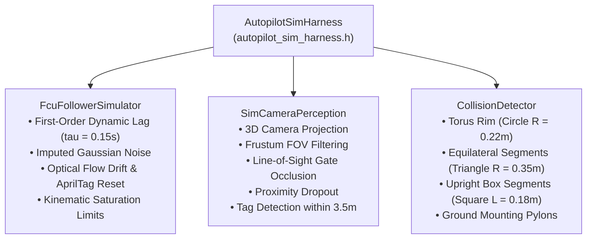

# Simulation Subsystem

The **Simulation Subsystem** provides a closed-loop Software-in-the-Loop (SIL) testbed for evaluating flight behavior, perception models, and collision safety prior to hardware deployment.

---

## Modular Component Structure

---

## 1. Follower Simulator ([`follower_simulator.h`](../sim/include/follower_simulator.h))

Simulates a physical drone executing ArduPilot guidance setpoints:

### First-Order Dynamic Lag
Translational velocity responds via exponential lag with time constant $\tau = 0.15\text{ s}$:
$$v_{k} = v_{k-1} + \frac{dt}{\tau} (v_{\text{cmd}} - v_{k-1})$$

### Imputed Sensor Noise
Adds zero-mean Gaussian noise to simulated position and orientation feedback:
- Position variance: $\sigma_p = 0.02\text{ m}$.
- Attitude variance: $\sigma_\psi = 0.01\text{ rad}$.

### Uncorrected Drift Simulation & Reset
Simulates continuous dead-reckoning drift (e.g. optical flow integrator accumulation). When an AprilTag measurement is processed, `correctDriftWithVision(tag)` simulates ArduPilot EKF3 fusion, snapping feedback back toward ground truth.

---

## 2. Synthetic Camera Perception ([`sim_camera_perception.h`](../sim/include/sim_camera_perception.h))

Emulates physical camera optics mounted at $(+0.18\text{ m forward}, +0.04\text{ m up})$:

- **Field of View Filtering**: Rejects gates outside the camera frustum (Horizontal $\pm 35^\circ$, Vertical $\pm 25^\circ$, Range $0.15\text{ m} \le d \le 6.0\text{ m}$).
- **Line-of-Sight Occlusion**: Raycasts lines of sight between the camera and gate targets. If a foreground gate lies along the ray within cylinder radius $0.28\text{ m}$, the background gate is marked occluded (`is_detected = 0`).
- **Proximity Edge Clipping**: Emulates camera contour loss at very close range ($d < 0.35\text{ m}$).
- **AprilTag Sighting**: Detects surveyed tags when the vehicle is within viewing distance ($d \le 3.5\text{ m}$).

---

## 3. High-Fidelity Collision Detector ([`collision_detector.h`](../sim/include/collision_detector.h))

Calculates clearance and rim impacts against physical gate structures ($r_{\text{drone}} = 0.06\text{ m}$, $r_{\text{tube}} = 0.03\text{ m}$, collision distance $= 0.09\text{ m}$):

1. **Circle Gate**: Torus aperture with major radius $R = 0.22\text{ m}$. Vertical mounting pylon below base ($w < -0.25\text{ m}$).
2. **Triangle Gate**: Equilateral triangle with circumradius $R = 0.35\text{ m}$ (apex UP). Vertical mounting pylon below base ($w < -0.205\text{ m}$).
3. **Square Gate**: Upright square with half-width $L = 0.1768\text{ m}$. Vertical mounting pylon below bottom edge ($w < -0.207\text{ m}$).

---

## 4. Execution Tools

- **CLI Scenario Runner**: [`autopilot_sim_runner`](../sim/src/sim_runner_main.cpp) executes repeatable headless automated scenario runs.
- **Real-Time Web Simulator**: [`sim_web.py`](../sim/sim_web.py) serves the Three.js browser visualizer on port 8080/5000, streaming real-time drone pose and obstacle clearance.
