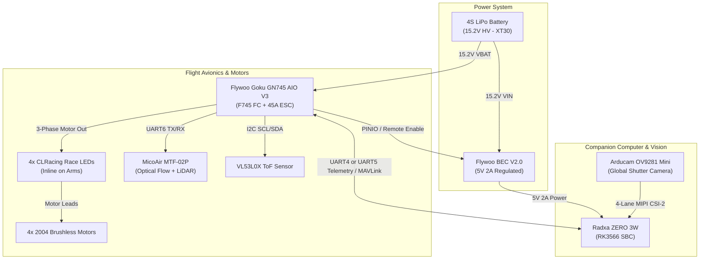

# Autonomous Drone Avionics & Electrical Component Guide
**KiCad Library: `Autonomous_Drone` (`Autonomous_Drone.kicad_sym` & `Autonomous_Drone.pretty`)**

This guide documents the electrical specifications, pinout assignments, mechanical dimensions, and system interconnect architecture for all components in the drone electrical subsystem.

---

## 1. Library Overview & KiCad Integration

The library is pre-configured for modern KiCad (v6, v7, v8, and v9) with standard S-expression definitions:
* **Symbol Library**: `Autonomous_Drone.kicad_sym`
* **Footprint Library**: `Autonomous_Drone.pretty/`
* **Project Registration**: `sym-lib-table` and `fp-lib-table` are located directly in this directory for automatic discovery when opening KiCad projects here.

### Component Summary Table

| Component | KiCad Symbol | Default Footprint | Key Interface / Function |
| :--- | :--- | :--- | :--- |
| **Radxa ZERO 3W (Full)** | `Radxa_ZERO_3W` | `Radxa_ZERO_3W` | RK3566 SBC, 40-Pin GPIO, 4-Lane MIPI CSI, Dual USB-C |
| **Radxa ZERO 3W (Modular)** | `Radxa_ZERO_3W_Modular` | `Radxa_ZERO_3W` | Multi-Unit: Unit A (GPIO), Unit B (CSI), Unit C (Power/USB) |
| **Flywoo Goku GN745 AIO V3** | `Flywoo_Goku_GN745_45A_AIO_V3` | `Flywoo_Goku_GN745_AIO_V3` | STM32F745 FC + 45A 4in1 ESC, 7 UARTs, I2C, Baro, OSD |
| **2004 Brushless Motor** | `Brushless_Motor_2004` | `Motor_Mount_2004_12x12mm_M2` | 3-Phase BLDC, 12x12mm M2 bolt pattern |
| **Tattu 4S 850mAh LiPo** | `Battery_4S_LiPo_XT30` | `AMASS_XT30PW_Horizontal_PTH` | 14.8V-17.4V HV LiPo, XT30 + JST-XH 5P balance |
| **XT30 Power Connector** | `Connector_XT30` | `AMASS_XT30PW_Horizontal_PTH` | AMASS XT30PW-M right-angle connector (30A) |
| **Flywoo 5V/12V 2A BEC V2.0** | `Flywoo_BEC_5V_12V_2A_V2` | `Flywoo_BEC_V2.0_17.5x6.5mm` | 2-6S input step-down, PINIO remote switch control |
| **Arducam Mini OV9281 (Pref.)** | `Camera_OV9281_MIPI_15Pin` | `Arducam_Mini_OV9281_24x25mm` | 1MP Mono Global Shutter, 15P MIPI CSI-2, FSIN sync |
| **DFRobot OV9281 (2nd Choice)** | `Camera_DFRobot_OV9281_38x38mm` | `DFRobot_OV9281_38x38mm` | 1MP Mono Global Shutter 79.3° FOV, 15P MIPI CSI-2 |
| **CLRacing Race LED Wire** | `CLRacing_Race_LED_8x25mm` | `CLRacing_Race_LED_8x25mm` | 3-Phase motor pass-through with throttle LEDs |
| **MicoAir MTF-02P** | `MicoAir_MTF-02P` | `MicoAir_MTF-02P_21.6x16mm` | Optical Flow + LiDAR rangefinder (UART 115200) |
| **ToF VL53L0X** | `Sensor_ToF_VL53L0X` | `Sensor_VL53L0X_Breakout_Header` | ST VL53L0X Laser ranging module (I2C) |
| **Radxa 22P CSI Connector** | `Connector_FPC_22Pin_0.5mm_Radxa_CSI` | `Connector_FPC_22Pin_0.5mm_Radxa_CSI` | 22-Pin 0.5mm pitch bottom-contact FPC |
| **RPi 15P CSI Connector** | `Connector_FPC_15Pin_1.0mm_RPi_CSI` | `Connector_FPC_15Pin_1.0mm_RPi_CSI` | 15-Pin 1.0mm pitch bottom-contact FPC |

---

## 2. Component Technical Specifications

### 2.1 Radxa ZERO 3W (SBC)
* **Processor**: Rockchip RK3566 Quad-Core ARM Cortex-A55 @ 1.6 GHz, Mali-G52 GPU, 0.8 TOPS NPU.
* **Form Factor**: 65.0 mm x 30.0 mm x 5.0 mm, 4x M2.5 mounting holes (58.0 mm x 23.0 mm center-to-center, 3.5 mm from edges).
* **Power Supply**:
  * +5.0V DC input on GPIO Pin 2 & Pin 4 (or USB-C 1 OTG port). Recommended adapter: 5V/2A or higher.
  * +3.3V power output from onboard PMIC on GPIO Pin 1 & Pin 17.
* **40-Pin GPIO Header Pinout Breakdown**:
  * **Pin 1**: `+3.3V` (Power Out)
  * **Pin 2**: `+5.0V` (Power In/Out)
  * **Pin 3**: `GPIO1_A0` / `I2C3_SDA_M0` / `UART3_RX_M0` (On-board pull-up to 3.3V)
  * **Pin 4**: `+5.0V` (Power In/Out)
  * **Pin 5**: `GPIO1_A1` / `I2C3_SCL_M0` / `UART3_TX_M0` (On-board pull-up to 3.3V)
  * **Pin 6**: `GND`
  * **Pin 7**: `GPIO3_C4` / `PWM14_M0`
  * **Pin 8**: `GPIO0_D1` / `UART2_TX_M0` (Default U-Boot / OS serial debug console TX, 1.5M baud)
  * **Pin 9**: `GND`
  * **Pin 10**: `GPIO0_D0` / `UART2_RX_M0` (Default U-Boot / OS serial debug console RX, 1.5M baud)
  * **Pin 11**: `GPIO3_A1`
  * **Pin 12**: `GPIO3_A3` / `I2S3_SCLK_M0`
  * **Pin 13**: `GPIO3_A2` / `I2S3_MCLK_M0`
  * **Pin 14**: `GND`
  * **Pin 15**: `GPIO3_B0`
  * **Pin 16**: `GPIO3_B1` / `UART4_RX_M1` / `PWM8_M0`
  * **Pin 17**: `+3.3V` (Power Out)
  * **Pin 18**: `GPIO3_B2` / `UART4_TX_M1` / `PWM9_M0`
  * **Pin 19**: `GPIO4_C3` / `SPI3_MOSI_M1` / `I2S3_SCLK_M1` / `PWM15_IR_M1`
  * **Pin 20**: `GND`
  * **Pin 21**: `GPIO4_C5` / `SPI3_MISO_M1` / `I2S3_SDO_M1` / `PWM12_M1` / `UART9_TX_M1`
  * **Pin 22**: `GPIO3_C1` / `I2S1_SDO2_M2`
  * **Pin 23**: `GPIO4_C2` / `SPI3_CLK_M1` / `I2S3_MCLK_M1` / `PWM14_M1`
  * **Pin 24**: `GPIO4_C6` / `SPI3_CS0_M1` / `PWM13_M1` / `UART9_RX_M1` / `I2S3_SDI_M1`
  * **Pin 25**: `GND`
  * **Pin 26**: `GPIO4_D1` / `SPI3_CS1_M1`
  * **Pin 27**: `GPIO4_B2` / `I2C4_SDA_M0` / `I2S2_SDI_M1` / Optional `USB2_HOST2_DP`
  * **Pin 28**: `GPIO4_B3` / `I2C4_SCL_M0` / `I2S2_SDO_M1` / Optional `USB2_HOST2_DM`
  * **Pin 29**: `GPIO3_B3` / `I2C5_SCL_M0`
  * **Pin 30**: `GND`
  * **Pin 31**: `GPIO3_B4` / `I2C5_SDA_M0`
  * **Pin 32**: `GPIO3_C2` / `UART5_TX_M1` / `I2S1_SDO3_M2`
  * **Pin 33**: `GPIO3_C3` / `UART5_RX_M1` / `I2S1_SCLK_RX_M2`
  * **Pin 34**: `GND`
  * **Pin 35**: `GPIO3_A4` / `I2S3_LRCK_M0`
  * **Pin 36**: `GPIO3_A7`
  * **Pin 37**: `GPIO1_A4` / `I2S1_SCLK_RX_M0`
  * **Pin 38**: `GPIO3_A6` / `I2S3_SDI_M0`
  * **Pin 39**: `GND`
  * **Pin 40**: `GPIO3_A5` / `I2S3_SDO_M0`

* **22-Pin 0.5mm Pitch MIPI CSI Interface**:
  * Pins C1, C4, C7, C10, C13, C16, C19: `GND`
  * Pins C2/C3: `MIPI_CSI_RX_D0N` / `MIPI_CSI_RX_D0P` (Data Lane 0)
  * Pins C5/C6: `MIPI_CSI_RX_D1N` / `MIPI_CSI_RX_D1P` (Data Lane 1)
  * Pins C8/C9: `MIPI_CSI_RX_CLK0N` / `MIPI_CSI_RX_CLK0P` (Clock Lane)
  * Pins C11/C12: `MIPI_CSI_RX_D2N` / `MIPI_CSI_RX_D2P` (Data Lane 2)
  * Pins C14/C15: `MIPI_CSI_RX_D3N` / `MIPI_CSI_RX_D3P` (Data Lane 3)
  * Pin C17: `CAMERAB_PDN_L` (Camera Power Down, active low)
  * Pin C18: `CIF_CLKOUT` (Camera Clock output)
  * Pins C20/C21: `I2C2_SCL_M1` / `I2C2_SDA_M1` (Camera Sensor I2C Bus)
  * Pin C22: `VCC_3V3` (3.3V Camera Power Supply)

---

### 2.2 Flywoo Goku GN745 45A AIO V3 (Flight Controller + 4in1 ESC)
* **MCU**: STM32F745 32-bit @ 216 MHz with 1MB Flash.
* **Gyro / IMU**: MPU6000.
* **Barometer**: SPL06.
* **OSD**: AT7456E analog OSD.
* **ESC Current**: 45A continuous, 50A burst (AM32 / BLHeli_32, DShot150/300/600/1200).
* **Dimensions**: 33.5 mm x 33.5 mm, 25.5 mm x 25.5 mm M3/M2 mounting pattern.
* **Power Output**: 5V @ 2.0A, 4.5V (USB VBUS powered for receiver config), 3.3V @ 0.5A.
* **Hardware UART Mapping**:
  * `UART1`: `RX1` (Inverted SBUS / Telemetry input)
  * `UART2`: `TX2`, `RX2` (Serial Receiver: ExpressLRS, Crossfire, TBS)
  * `UART3`: `TX3`, `RX3` (SmartAudio, IRC Tramp, Analog VTX)
  * `UART4`: `TX4`, `RX4` (DJI HD O3/O4 MSP display port)
  * `UART5`: `TX5`, `RX5` (DJI HD auxiliary or companion telemetry)
  * `UART6`: `TX6`, `RX6` (GPS module / Optical Flow)
  * `UART7`: Internal ESC telemetry / current monitoring
* **I2C Bus**: `SCL`, `SDA` (External Magnetometer / Compass / Baro).

---

### 2.3 Brushless Motors (Emax ECO II 2004 / GEPRC GR2004)
* **Configuration**: 12N14P 3-Phase BLDC.
* **KV**: 2400KV (Emax) / 2550KV (GEPRC), optimized for 4S LiPo and 3-5 inch props.
* **Mounting**: 4x M2 holes on 12.0 mm x 12.0 mm bolt square pattern (Ø16.97 mm bolt circle).
* **Center Shaft Clearance**: Ø5.0 mm.
* **Motor Bell Diameter**: Ø24.5 mm.
* **Wiring**: 3 heavy-gauge flexible phase leads (A, B, C) soldering to ESC / Race LED.

---

### 2.4 Battery & Power Connectors (Tattu 4S 850mAh HV)
* **Chemistry**: 4S1P 15.2V High Voltage (HV) LiPo (4.35V/cell full charge = 17.4V max; 3.5V/cell cutoff = 14.0V).
* **Discharge Rating**: 95C continuous (over 80A burst).
* **Main Discharge Connector**: AMASS XT30 (Pin 1: Positive `+`, Pin 2: Negative `-`).
* **Balance Connector**: JST-XH 5-Pin 2.50 mm Pitch:
  * Pin 1: `GND` (Cell 1 Negative)
  * Pin 2: `Cell 1+` (3.8V nom / 4.35V max)
  * Pin 3: `Cell 2+` (7.6V nom / 8.70V max)
  * Pin 4: `Cell 3+` (11.4V nom / 13.05V max)
  * Pin 5: `Cell 4+` (15.2V nom / 17.40V max)

---

### 2.5 Flywoo 5V/12V 2A BEC Module V2.0
* **Input Voltage**: 2S-6S LiPo (7.0V to 26.0V DC).
* **Output Voltage**: 5.0V @ 2A (default, open jumper) or 12.0V @ 2A (bridged jumper).
* **Dimensions**: 17.5 mm x 6.5 mm.
* **Remote Switch Control (`CON` Pad)**:
  * Connect to Flight Controller `LED_STRIP` or free GPIO pad configured with Betaflight PINIO (`resource PINIO 1 <PAD>`).
  * Enables software-switched power gating for the SBC, VTX, or auxiliary peripherals.

---

### 2.6 Cameras (Arducam Mini OV9281 vs DFRobot OV9281)
* **Sensor**: OmniVision OV9281 1/4" Monochrome Global Shutter CMOS.
* **Resolution**: 1280 x 800 @ 120 fps (up to 210 fps at lower resolutions).
* **Shutter Type**: Global shutter (zero motion blur or rolling-shutter "jello" effect, ideal for computer vision & VIO/SLAM).
* **Arducam Mini OV9281 (Preferred)**:
  * Board Size: 24.0 mm x 25.0 mm, 4x M2 mounting holes (20.0 x 21.0 mm spacing).
  * Interface: 15-Pin 1.0 mm pitch FPC (Standard RPi pinout), connects to Radxa Zero 3W via a 15-pin to 22-pin 0.5 mm adapter ribbon cable.
  * Trigger / Strobe: Auxiliary pads for `FSIN` (hardware sync pulse input) and `STROBE` (exposure flash output).
* **DFRobot OV9281 (Second Choice)**:
  * Board Size: 38.0 mm x 38.0 mm, 4x M2.5/M3 holes (28.0 x 28.0 mm spacing), 79.3° FOV lens.

---

### 2.7 CLRacing Race LED / PCB Wire (8x25mm)
* **Dimensions**: 8.0 mm x 25.0 mm.
* **Operation**: Placed inline on each drone arm between the 4-in-1 ESC motor pads and the brushless motor leads.
* **Pads**: 3 pads on ESC side (`ESC_A`, `ESC_B`, `ESC_C`) and 3 pads on motor side (`MOT_A`, `MOT_B`, `MOT_C`).
* **Feature**: Throttle-reactive integrated LEDs draw power directly from AC phase PWM; no data lines, 5V, or configuration needed.

---

### 2.8 MicoAir MTF-02P (Optical Flow + LiDAR)
* **Dimensions**: 21.6 mm x 16.0 mm x 6.5 mm, weight 1.5g.
* **Sensors**: Optical flow motion sensor + Time-of-Flight LiDAR distance rangefinder.
* **Interface**: 4-Pin JST-SH 1.0 mm connector (Pin 1: `GND`, Pin 2: `+5V`, Pin 3: `RX`, Pin 4: `TX`).
* **Baud Rate**: 115200 bps @ 50 Hz update rate (connects to FC `UART6` or Radxa `UART4`/`UART5`).

---

### 2.9 ToF VL53L0X Distance Sensor
* **Dimensions**: 25.4 mm x 10.7 mm breakout with 1x6 2.54 mm header.
* **Range**: Up to 2.0 meters (940 nm VCSEL infrared laser).
* **Interface**: I2C (Pin 1: `VIN` 2.8V-5V, Pin 2: `GND`, Pin 3: `SCL`, Pin 4: `SDA`, Pin 5: `GPIO1`/Interrupt, Pin 6: `XSHUT`).

---

## 3. Recommended Interconnection Architecture

### Specific Interconnect Table

| Source Device & Pin | Destination Device & Pin | Function |
| :--- | :--- | :--- |
| **Battery XT30 (+)** | **Goku AIO `BAT+`** & **BEC `VIN`** | Raw 4S LiPo Power (14.0V - 17.4V) |
| **Battery XT30 (-)** | **Goku AIO `BAT-`** & **BEC `GND`** | System Ground Reference |
| **BEC `VOUT` (5V)** | **Radxa ZERO 3W `Pin 2` & `Pin 4`** | Regulated 5V / 2A SBC Power |
| **BEC `GND`** | **Radxa ZERO 3W `Pin 6` (GND)** | Power Ground Return |
| **Goku AIO `LED_STRIP`** | **BEC `CON` (Control)** | Remote Power Gate (PINIO controlled) |
| **Radxa `Pin 8` (UART2_TX)** | Debug Terminal / FTDI RX | U-Boot Serial Console (1.5M baud) |
| **Radxa `Pin 10` (UART2_RX)** | Debug Terminal / FTDI TX | U-Boot Serial Console (1.5M baud) |
| **Radxa `Pin 16` (UART4_RX)** | **Goku AIO `TX5`** | High-Speed Companion Link (MAVLink / ROS2) |
| **Radxa `Pin 18` (UART4_TX)** | **Goku AIO `RX5`** | High-Speed Companion Link (MAVLink / ROS2) |
| **Radxa MIPI CSI (C1-C22)** | **Arducam OV9281 (1-15)** | High-Bandwidth Global Shutter Camera Stream |
| **Goku AIO `TX6` / `RX6`** | **MTF-02P `RX` / `TX`** | Optical Flow & Altitude LiDAR Data (115200 baud) |
| **Goku AIO `5V` / `GND`** | **MTF-02P `5V` / `GND`** | Sensor Power |
| **Goku AIO `SCL` / `SDA`** | **VL53L0X `SCL` / `SDA`** | Obstacle Sensing I2C Bus |
| **Goku AIO `3.3V` / `GND`** | **VL53L0X `VIN` / `GND`** | Sensor Power |
| **Goku AIO Motor Pads (M1-M4)** | **CLRacing Race LEDs (ESC side)** | 3-Phase AC Motor PWM Signals |
| **CLRacing Race LEDs (MOT side)** | **2004 Brushless Motors (A, B, C)** | High Current Motor Driving Leads |

---
*Created for the Autonomous Drone Electrical System.*
