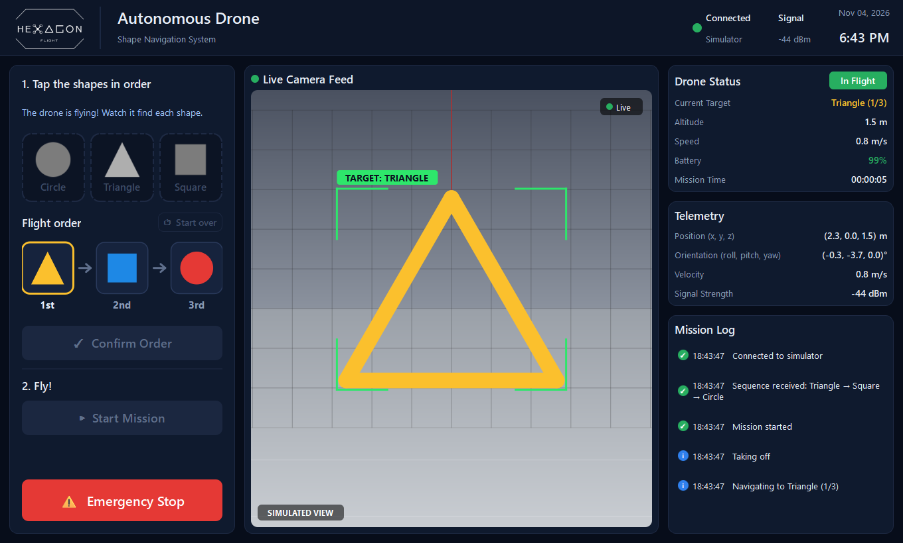

# Operator GUI

The ground-station app for the Hexagon Flight autonomous drone demo. An operator (or a
young audience member) picks the order of the three shapes, confirms it, starts the
mission, and can hit the emergency stop at any time. The screen shows a live camera
view, the drone's status and telemetry, and a running mission log.



> **Status: works end to end on the built-in simulator. Not yet flown with the real
> drone.** Some of the values on screen are simulated or placeholders until the
> autopilot, vision and hardware teams supply the real data. See
> [Placeholders and simulated data](#placeholders-and-simulated-data) and the
> [integration plan](#integration-plan) below.

## What the audience can do

The controls are deliberately limited to four actions, so there's nothing to get wrong:

1. **Tap the shapes in order.** Tap Circle, Triangle and Square in the order the drone
   should fly through them. Each shape can be used once, so a used shape greys out. The
   numbered boxes (1st, 2nd, 3rd) fill in as you go. **↺ Start over** clears the order.
2. **Confirm Order.** This works once all three are picked. The order is sent to the
   autopilot, and the button only turns into "Order Confirmed" once the autopilot accepts it.
3. **Start Mission.** This only works after the order is confirmed.
4. **Emergency Stop.** Always available, and it acts immediately (no "are you sure?").

A hint line under the title always says what to do next.

## What's on screen

| Panel | Shows |
|---|---|
| Header | Team logo, connection status, signal strength, date and time |
| Live Camera Feed | Simulated arena view, a webcam, or a video stream (see `--camera`); the current target is boxed |
| Flight order | The chosen order. During a mission, the current shape is highlighted and finished ones get a ✓ |
| Drone Status | Mission state badge, current target, altitude, speed, battery, mission time |
| Telemetry | Position (x, y, z), orientation (roll, pitch, yaw), velocity, signal strength |
| Mission Log | Timestamped events: order received, taking off, looking for / found / flew through each shape, landing, emergency stop |

A value shows **"—"** when the data source doesn't provide it.

## Setup (Windows, PowerShell)

Requires Python 3.12 (3.10 or newer should work).

```powershell
cd ui
python -m venv .venv
.\.venv\Scripts\Activate.ps1
pip install -r requirements.txt
```

## Running

```powershell
python -m drone_ui.app                                     # built-in simulator (default)
python -m drone_ui.app --autopilot 127.0.0.1               # real autopilot on this machine (e.g. WSL)
python -m drone_ui.app --autopilot 192.168.4.1             # real autopilot over the drone's Wi-Fi
python -m drone_ui.app --autopilot 192.168.4.1 --camera webcam
python -m pytest                                           # tests
```

`--camera` takes one of:

| Value | Feed |
|---|---|
| `sim` | Rendered view of the simulated arena (default with the simulator) |
| `webcam` | The computer's default camera |
| a URL | A network video stream, e.g. `rtsp://192.168.4.1:8554/cam` or an HTTP MJPEG stream |
| `none` | No feed (default with `--autopilot`, since the simulated view needs simulated positions) |

## Data sources

All the panels read from one `DroneState`, so they look and behave the same whichever
backend is running:

- **`SimBackend`** (default): a pretend drone that takes off from a fixed landing pad,
  flies through the shapes in the chosen order, returns to the pad and lands. It runs
  10 times a second. Every value it shows is simulated. It's for demos and development
  without hardware.
- **`AutopilotBackend`** (`--autopilot HOST`): talks to the real autopilot over UDP
  using the shared packet formats in [`shared/include/`](../shared/include):

| Direction | Port | Packet | Used for |
|---|---|---|---|
| GUI → autopilot | 14552 | `UICommandPacket` | `SET_SEQUENCE` on Confirm, `START_MISSION` on Start (with the order and `end_action = LAND`), `ESTOP` (sent 3×), `NONE` 4× per second as a status poll |
| autopilot → GUI | reply to sender | `UIStatusPacket` | Flight state, which shape it's on, battery, command acknowledgement, connection light |
| autopilot → GUI | 14554 | `TelemetryPacket` | Position, velocity, attitude, which shapes the camera is tracking |

The autopilot only sends a status packet in reply to a command, so the GUI polls with
`UI_CMD_NONE`. The JSON debug log that also arrives on port 14554 is ignored.

## Placeholders and simulated data

What's real and what isn't in **`--autopilot` mode**, as of the current `main` branch:

| Shown in GUI | Source today | State |
|---|---|---|
| Mission state, current target, progress ✓s | `UIStatusPacket.flight_state` / `current_seq_index` | **Real** (from the autopilot's state machine) |
| Command acknowledgement ("Order Confirmed") | `UIStatusPacket.last_acked_cmd_id` / `cmd_ack_result` | **Real** |
| Mission log | Derived by the GUI from status and telemetry changes | **Real** (as real as its inputs) |
| "Camera spotted the …" log lines | `TelemetryPacket.goals[].state` | **Real** (from the goal estimator) |
| Mission time | Timed by the GUI from takeoff | **Real** |
| Battery | `UIStatusPacket.battery_remaining` | **Placeholder:** the autopilot always sends 90% (and 12.0 V) |
| Position / altitude | `TelemetryPacket.drone_pos_ned` | Real field, but positions come from the team simulator (`autopilot/sim/sim_web.py`) until the MAVLink link to the flight controller is finished |
| Speed / velocity | `TelemetryPacket.drone_vel_ned` | **Placeholder:** not filled in yet (zeros), so the GUI estimates speed from successive positions |
| Orientation (roll, pitch, yaw) | `TelemetryPacket.drone_att_ned` | **Not filled in yet:** shows "—" |
| Signal strength | No field in any packet yet | **Missing:** shows "—" |
| Camera feed | `--camera` | **Simulated** (`sim`) or a webcam until the drone streams video |

Other limitations:

- **Telemetry only reaches a GUI on the drone itself.** The autopilot sends
  `TelemetryPacket` to `127.0.0.1` only (see the `AutopilotNode` constructor). Over Wi-Fi,
  commands and status work, but position, speed and attitude show "—".
- **The landing spot differs between the two modes.** The simulator flies back to the
  landing pad before landing. The real autopilot lands wherever it is after the last shape.
- **Emergency stops can come from the drone itself.** The autopilot trips its own
  emergency stop if vision goes quiet for 0.2 s mid-flight, so the GUI can show
  "Emergency Stop" without anyone pressing the button.

In **simulator mode**, everything on screen is simulated, including the battery
drain, signal strength and camera view. The panel is labelled `SIMULATED VIEW`.

## Integration plan

The GUI already has a place for every value it shows. Swapping placeholders for real data
mostly happens on the autopilot/drone side, and the GUI picks it up automatically:

1. **Battery:** have the autopilot fill `battery_voltage` / `battery_remaining` from the
   flight controller's MAVLink `SYS_STATUS` instead of the fixed 12.0 V / 90%. *No GUI change.*
2. **Velocity and attitude:** fill `drone_vel_ned` and `drone_att_ned` in the autopilot's
   `TelemetryPacket` (from the flight controller's EKF). The GUI will use the real velocity
   instead of its estimate, and orientation will appear. *No GUI change.*
3. **Real position:** finish the MAVLink parsing in `autopilot/mavlink-daemon` so positions
   come from the flight controller instead of the simulator. *No GUI change.*
4. **Telemetry over Wi-Fi:** send `TelemetryPacket` to the GUI's address (for example the
   address the last `UICommandPacket` came from) instead of `127.0.0.1`. *No GUI change.*
5. **Signal strength:** agree with the team on a field for Wi-Fi RSSI (for example in
   `UIStatusPacket` or `TelemetryPacket`), add it to the header, then map it in
   `AutopilotBackend`. *Small GUI change, plus a header change that `protocol.py` must mirror.*
6. **Camera:** stream the drone's camera (ideally the vision node's annotated frames) from
   the Pi over RTSP or MJPEG, then run with `--camera <stream URL>`. *No GUI change.*
7. **First real-hardware test:** run with `--autopilot 192.168.4.1` on the drone's Wi-Fi,
   check each row of the placeholders table, and update this README.

When the team changes a packet in `shared/include/`, update `drone_ui/protocol.py` to match.
`tests/test_protocol.py` reads the C headers directly and fails if the Python and C layouts
differ, because the autopilot silently drops packets of the wrong size.

## Code layout

```
ui/
├── drone_ui/
│   ├── app.py         main window, theme, command-line options
│   ├── widgets.py     header + logo, shape buttons, flight order, camera view, status cards, log
│   ├── backends.py    SimBackend (pretend mission) and AutopilotBackend (UDP to the autopilot)
│   ├── model.py       DroneState, shapes, mission phases: what the screen displays
│   ├── protocol.py    Python mirrors of the packets in shared/include/
│   └── assets/        team logo
├── tests/
│   ├── test_protocol.py           packets vs. the C headers
│   ├── test_app.py                shape picking, button rules, simulated mission
│   └── test_autopilot_backend.py  full command/status/telemetry flow against a fake autopilot
├── docs/              screenshots for this README
└── requirements.txt
```

## Testing

```powershell
python -m pytest
```

The tests run without a display or hardware. They cover:

- the Python packets matching the C headers
- the tap-in-order rules and button enabling
- a full simulated mission
- the autopilot backend against a fake autopilot that answers like
  `AutopilotNode::handleUICommand`: connect, confirm, rejected confirm, start, progress,
  landing, emergency stop, telemetry, and the no-autopilot timeout
