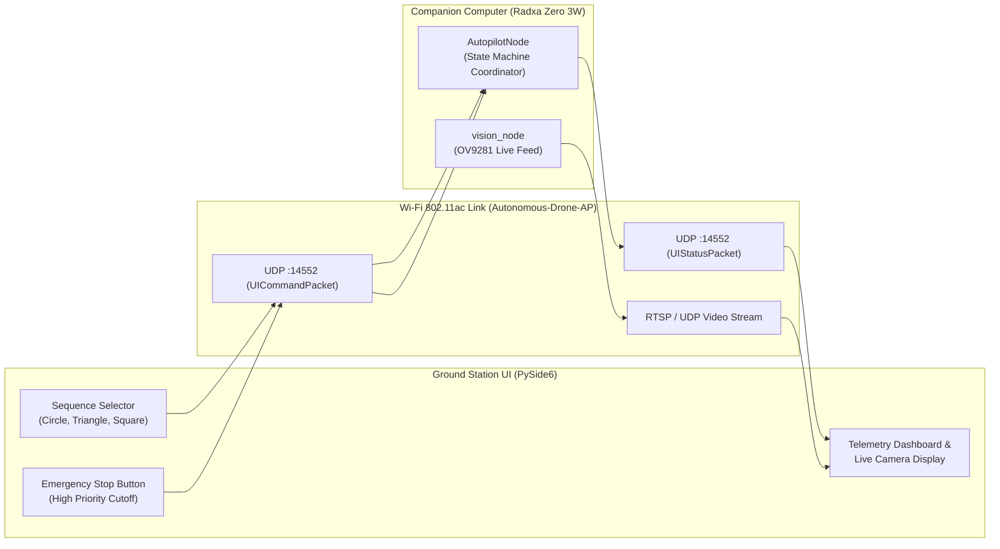

# User Interface (UI) Subsystem

[](https://www.python.org/)
[-brightgreen.svg)](https://wiki.qt.io/Qt_for_Python)
[-orange.svg)](#network-communication--protocol)

The **User Interface Subsystem** provides an intuitive, accessible desktop Ground Control Station (GCS) application for operating, configuring, and monitoring the autonomous drone during public demonstrations at the University of Kentucky Engineering Day (E-Day).

Developed in Python using **PySide6 (Qt6)**, the UI allows operators and visitors to select an arbitrary geometric gate traversal sequence (Circle, Triangle, Square), monitor real-time vehicle telemetry and live camera feeds, and trigger an immediate hardware-safe **Emergency Stop**.

---

## Table of Contents

- [Subsystem Overview](#subsystem-overview)
- [Application Layout & Features](#application-layout--features)
  - [1. Goal Sequence Selection](#1-goal-sequence-selection)
  - [2. Live Camera Feed Display](#2-live-camera-feed-display)
  - [3. Telemetry & Flight Status Dashboard](#3-telemetry--flight-status-dashboard)
  - [4. Mission Controls & Safety E-Stop](#4-mission-controls--safety-e-stop)
  - [5. Mission Event Log](#5-mission-event-log)
- [Network Communication & Protocol](#network-communication--protocol)
- [Directory Layout](#directory-layout)
- [Development Environment Setup](#development-environment-setup)
- [Running Against the Autopilot Simulation](#running-against-the-autopilot-simulation)
- [Requirements Verification](#requirements-verification)

---

## Subsystem Overview



---

## Application Layout & Features

Based on the preliminary interface design (PDR Section 5.3.6, Figure 14):

### 1. Goal Sequence Selection
- Interactive drag-and-drop or dropdown cards allowing the user to select the order of gates to traverse (e.g. `1: Circle` $\to$ `2: Triangle` $\to$ `3: Square`).
- Displays a visual preview bar showing target polygons with color-coded identifiers.
- Transmits a structured sequence array upon clicking **"Confirm Sequence"**.

### 2. Live Camera Feed Display
- Ingests the 120 FPS camera stream forwarded by the companion SBC.
- Overlays real-time computer vision annotations:
  - Detected contour bounding boxes and shape classification labels.
  - Calculated 3D distance and relative orientation vectors.
  - Target lock crosshairs when `GoalEstimator` transitions to `LOCKED`.

### 3. Telemetry & Flight Status Dashboard
- **Flight Mode**: Displays active state (`STANDBY`, `TAKEOFF`, `GOAL_SEEK`, `TRAVERSAL`, `HOVER_WAIT`, `LAND`).
- **Vehicle Position & Velocity**: Real-time World NED coordinates $(x, y, z)$ and speed magnitude.
- **Attitude Indicators**: Roll, pitch, and yaw readouts.
- **Battery Health**: Pack voltage (e.g. 15.2 V), percentage, and cell health indicators.
- **Link Quality**: Live round-trip packet latency and packet loss metrics.

### 4. Mission Controls & Safety E-Stop
- **"Start Mission"**: Initiates autonomous arming, takeoff to $1.0\text{ m}$ hover, and gate search.
- **"Emergency Stop"**: A prominent, high-visibility red pushbutton that immediately transmits `UI_CMD_ESTOP`. The autopilot forces an instantaneous motor disarm override within $\le 150\text{ ms}$ (**ER 10**).
- **"Land Now"**: Initiates a smooth, controlled vertical descent to touchdown.

### 5. Mission Event Log
- Scrollable console logging mission events with microsecond timestamps:
  ```
  [10:22:15] Connected to drone at 192.168.4.1:14552
  [10:22:20] Sequence confirmed: Circle -> Triangle -> Square
  [10:22:25] Armed in GUIDED mode. Ascending to 1.0 m hover.
  [10:22:31] Goal LOCKED: Circle (x=1.82m, y=0.10m, z=1.02m)
  [10:22:38] Gate 1 (Circle) traversed successfully. Advancing to Triangle.
  ```

---

## Network Communication & Protocol

The UI communicates with the SBC over the drone's dedicated onboard Wi-Fi network:
- **SSID**: `Autonomous-Drone-AP` (Password: `DronePilot123`).
- **Drone Static IP**: `192.168.4.1`.
- **Port**: `14552` (UDP).

### Wire Protocol Integration ([`shared/include/ui_protocol.h`](file:///home/sandbox/autonomous-drone/shared/include/ui_protocol.h))

The UI packages binary packets matching C structure definitions:

```python
import struct

# UICommandPacket (Packed C struct)
# uint8 msg_type (2), uint32 cmd_id, uint64 timestamp, uint8 cmd, uint8 seq_len, uint8[16] goals, ...
CMD_STRUCT = struct.Struct("<BIQB B16s B f B f f")

def send_mission_sequence(sock, drone_addr, sequence):
    seq_bytes = bytes(sequence) + b'\x00' * (16 - len(sequence))
    packet = CMD_STRUCT.pack(
        2,              # MSG_TYPE_UI_CMD
        1,              # Command ID
        0,              # Host timestamp
        8,              # UI_CMD_SET_SEQUENCE
        len(sequence),  # sequence_length
        seq_bytes,      # goal_sequence
        1,              # end_action (1 = AUTO_LAND)
        0.0,            # hover_timeout
        0, 0.0, 0.0     # tube constraints
    )
    sock.sendto(packet, drone_addr)
```

---

## Directory Layout

```
ui/
├── README.md                   # This documentation
├── requirements.txt            # Python dependencies (PySide6, opencv-python)
├── main.py                     # Application entry point
├── app/
│   ├── main_window.py          # Primary PySide6 window layout and event wiring
│   ├── widgets/
│   │   ├── sequence_widget.py  # Drag-and-drop goal sequence ordering
│   │   ├── camera_widget.py    # OpenCV video stream widget
│   │   ├── telemetry_widget.py # Attitude, position, and battery gauges
│   │   └── control_widget.py   # Start Mission, Land, and Emergency Stop buttons
│   ├── comms/
│   │   ├── udp_client.py       # Non-blocking async UDP socket client
│   │   └── protocol.py         # Binary packet serialization (UICommandPacket)
│   └── styles/
│       └── dark_theme.qss      # High-contrast dark styling for outdoor visibility
└── tests/
    └── test_ui_protocol.py     # Loopback packet encoding/decoding tests
```

---

## Development Environment Setup

1. **Create and Activate Virtual Environment**:
   ```bash
   python3 -m venv venv
   source venv/bin/activate
   ```
2. **Install Dependencies**:
   ```bash
   pip install PySide6 opencv-python numpy
   ```
3. **Run the Interface**:
   ```bash
   python3 ui/main.py --host 127.0.0.1 --port 14552
   ```

---

## Running Against the Autopilot Simulation

Test the UI locally on a development machine without physical drone hardware:

1. **Start the Autopilot Simulation**:
   ```bash
   ./build/autopilot/sim/autopilot_sim_runner --scenario nominal
   ```
2. **Launch the UI in Local Mode**:
   ```bash
   python3 ui/main.py --host 127.0.0.1 --port 14552
   ```
3. Select `Circle` $\to$ `Triangle` $\to$ `Square`, click **Confirm Sequence**, and hit **Start Mission**. Verify that the telemetry gauges track simulated drone movements.

---

## Requirements Verification

- **ER 10 (Emergency Stop Response $\le 150\text{ ms}$)**: E-Stop button bypasses queueing and immediately transmits `UI_CMD_ESTOP` datagrams over a dedicated high-priority socket channel.
- **ER 18 (UI Acknowledgment Latency $\le 250\text{ ms}$)**: Monotonic command IDs ensure that acknowledgments (`sequence_id`) are verified within $< 15\text{ ms}$ across local Wi-Fi.
- **ER 19 (Wireless Reliability $\ge 10\text{ m}$, loss $< 2\%$)**: Lightweight 77-byte packets with sequence number tracking to detect dropped datagrams.
