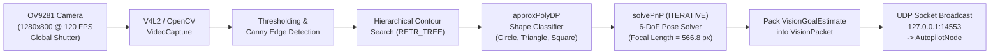

# Vision Processing Subsystem

[](https://en.cppreference.com/w/cpp/17)
[](https://opencv.org/)
[](#optical-hardware--illumination-strategy)

The **Vision Processing Subsystem** provides onboard, real-time computer vision capabilities for the autonomous drone. Running locally on the **Radxa Zero 3W** single-board computer, the pipeline ingests high-frame-rate monochrome video, isolates target gate geometries, classifies polygon shapes, solves for 6-DoF relative poses using perspective-n-point (`solvePnP`), and streams structured [`VisionPacket`](../shared/include/vision_packet.h) datagrams to the autopilot over UDP.

---

## Table of Contents

- [Subsystem Overview](#subsystem-overview)
- [Directory Layout](#directory-layout)
- [Optical Hardware & Illumination Strategy](#optical-hardware--illumination-strategy)
- [Core Detection & Pose Pipeline](#core-detection--pose-pipeline)
  - [1. Contour Extraction & Filtering](#1-contour-extraction--filtering)
  - [2. Geometric Polygon Classification](#2-geometric-polygon-classification)
  - [3. 6-DoF Pose Estimation via `solvePnP`](#3-6-dof-pose-estimation-via-solvepnp)
- [Physical Dimensions & Camera Calibration](#physical-dimensions--camera-calibration)
- [CLI Tools & Utilities](#cli-tools--utilities)
- [Building & Testing](#building--testing)
- [Production Headless Deployment](#production-headless-deployment)

---

## Subsystem Overview



---

## Directory Layout

```
vision-processing/
├── CMakeLists.txt                 # Builds gate_detector, vision_node, and test suite
├── include/
│   └── gate_detector.h            # Modular core detection and pose API
├── src/
│   └── gate_detector.cpp          # Full C++17 implementation in SI units
├── AdvancedVisionTesting.cpp       # Production vision node (compiled as vision_node)
├── FocalLengthCalibration.cpp     # Pinhole camera focal length calibration tool
├── ColorVisionTesting.cpp         # HSV segmentation prototype with GUI sliders
├── OpenCVTesting.cpp              # Baseline Canny & contour extraction prototype
├── PythonVisionTesting.py         # Standalone prototype with auto-polarity thresholding
├── notes.md                       # Subsystem technical notes
└── tests/
    └── test_vision.cpp            # GoogleTest suite for classification & PnP accuracy
```

---

## Optical Hardware & Illumination Strategy

To satisfy strict mass, cost, and high-speed motion constraints:

1. **Global Shutter Image Sensor (Innomaker / Arducam OV9281)**:
   - **Resolution**: 1 MP ($1280 \times 800$ native, scaled for processing).
   - **Shutter Type**: Hardware **Global Shutter**. Captures every pixel simultaneously, eliminating the rolling-shutter "jello" warping and shear that corrupts fast-moving aerial contour tracking.
   - **Interface**: 2-lane MIPI CSI-2 directly into the Radxa Zero 3W.
   - **Field of View (FOV)**: 79° horizontal.

2. **Retroreflective Active Illumination**:
   - Because the OV9281 is a monochrome sensor (chosen for cost and high sensitivity), color segmentation is not viable.
   - The perimeter of all target gates is lined with **industrial retroreflective tape**.
   - A high-intensity narrow-beam white LED is mounted adjacent to the camera lens.
   - Operating at elevated shutter speeds suppresses diffuse ambient room light to black, causing retroreflected light from the target apertures to illuminate with extreme contrast, ensuring robust edge extraction.

---

## Core Detection & Pose Pipeline

### 1. Contour Extraction & Filtering
- Converts the grayscale frame into an edge representation using Canny edge detection or adaptive Otsu thresholding.
- Performs hierarchical contour extraction using `cv::findContours(..., cv::RETR_TREE, cv::CHAIN_APPROX_SIMPLE)`.
- Hierarchical inspection isolates nested concentric contours, filtering the outer structural gate border from the inner traversal aperture.
- Rejects noise contours based on minimum area and aspect ratio thresholds.

### 2. Geometric Polygon Classification
The Douglas-Peucker polygon approximation algorithm (`cv::approxPolyDP`) evaluates vertex count with precision $\epsilon = 0.04 \times \text{perimeter}$:
- **Triangle**: 3 distinct vertices.
- **Square / Rectangle**: 4 vertices with internal orthogonal angle checks ($\sim 90^\circ$).
- **Pentagon**: 5 vertices.
- **Circle**: $\ge 8$ vertices with circularity ratio metric:
  $$\text{Circularity} = \frac{4\pi \times \text{Area}}{\text{Perimeter}^2} \ge 0.82$$

### 3. 6-DoF Pose Estimation via `solvePnP`
Once aperture vertices are extracted and ordered consistently (top-left, top-right, bottom-right, bottom-left):
- `cv::solvePnP` computes the rotation vector $\mathbf{r}$ and translation vector $\mathbf{t}$ relative to the camera optical frame.
- Model geometry is represented in **SI meters** matching the physical gates ($11.25\text{ in} = 0.28575\text{ m}$).
- The Rodrigues rotation vector is converted to a unit quaternion $(w, x, y, z)$ via `cv::Rodrigues`.
- Relative translation coordinates $(x, y, z)$ are packaged in meters.

---

## Physical Dimensions & Camera Calibration

| Parameter | Imperial | Metric (SI) | Description |
| :--- | :--- | :--- | :--- |
| **`FOCAL_LENGTH`** | `566.8` px | `566.8` px | Calibrated focal length for OV9281 |
| **Square Gate Opening** | `11.25` in | `0.28575` m | Traversal opening width & height |
| **Pentagon Gate Opening** | `11.75` in | `0.29845` m | Maximum width across upper vertices |
| **Triangle Gate Base** | `13.0` in | `0.3302` m | Internal base width |

---

## CLI Tools & Utilities

### 1. Production Vision Node (`vision_node`)
Runs continuous detection on live video and broadcasts UDP telemetry:
```bash
# Run headless with live camera index 0 streaming to local autopilot
./build/vision-processing/vision_node --headless --camera 0 --port 14553

# Run on a recorded video file with debug GUI windows
./build/vision-processing/vision_node --camera test_flight.mp4 --port 14553
```

### 2. Focal Length Calibration (`focal_calibration`)
Calibrates camera focal length ($F = (P \times D) / W$) using a known target at a fixed distance:
```bash
./build/vision-processing/focal_calibration
```

---

## Building & Testing

Requires OpenCV 4 (`libopencv-dev`):

```bash
# Build vision subsystem
cmake -B build -DCMAKE_BUILD_TYPE=Release
cmake --build build --target vision_node test_vision -j$(nproc)

# Run vision unit tests
ctest --test-dir build -R test_vision --output-on-failure
```

---

## Production Headless Deployment

On the Radxa Zero 3W embedded operating system, the vision daemon is managed by systemd:

```bash
# Check service status
systemctl status drone-vision.service

# View real-time log output
journalctl -u drone-vision.service -f
```
The service executes `/opt/drone/bin/vision_node --headless --camera 0 --port 14553` following CSI camera sensor initialization via `/opt/drone/scripts/init_camera.sh`.
